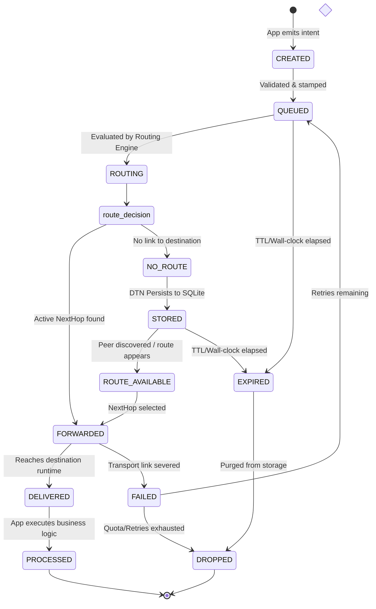
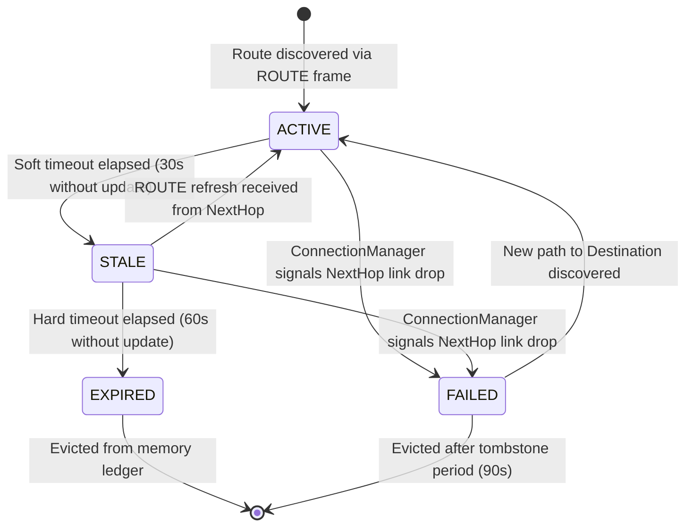

# FIELDNET Architecture — Document 05: Network Protocol, Routing & Delay-Tolerant Networking (DTN)

**Document Version:** 1.2  
**Phase:** 05 — Prompt 03 (Protocol, Routing & DTN Implementation Blueprint — FINAL ARCHITECTURE)  
**Status:** ARCHITECTURAL SPECIFICATION (Implementation Deferred to BUILD-01)  
**Authoritative Reference:** `FIELDNET_MASTER_SPEC.md`  
**Dependencies:** `docs/architecture/01-system-model.md`, `docs/architecture/02-runtime-architecture.md`, `docs/architecture/03-security.md`, `docs/architecture/04-networking.md`

---

## 1. Architectural Separation: Protocol vs. Routing vs. DTN

FIELDNET separates decentralized communication into three strictly decoupled architectural layers. Conflating these layers degrades modularity, couples message semantics to ephemeral network topologies, and makes offline/delay-tolerant operation impossible.

```text
┌────────────────────────────────────────────────────────────────────────┐
│                              APPLICATION                               │
└───────────────────────────────────┬────────────────────────────────────┘
                                    │ Application Payload
                                    ▼
┌────────────────────────────────────────────────────────────────────────┐
│ 1. PROTOCOL LAYER ("What does this message mean?")                     │
│    - Defines message structure, semantics, types, and serialization    │
│    - Provides end-to-end identity, integrity, and replay defense       │
│    - Agnostic to network topology, radio media, and hop counts         │
└───────────────────────────────────┬────────────────────────────────────┘
                                    │ Logical Message (Source -> Dest)
                                    ▼
┌────────────────────────────────────────────────────────────────────────┐
│ 2. ROUTING LAYER ("Where should this message go right now?")           │
│    - Determines the next immediate hop toward destination NodeId       │
│    - Maintains dynamic multi-hop routing table                         │
│    - Dispatches to single-hop physical neighbor via ConnectionManager  │
└───────────────────┬────────────────────────────────┬───────────────────┘
     Route Found    │                                │ No Active Route
                    ▼                                ▼
┌───────────────────────────────┐ ┌──────────────────────────────────────┐
│ Single-Hop Physical Transport │ │ 3. DTN LAYER ("What to do when       │
│ (Wi-Fi, BLE, Ethernet)        │ │    nowhere is available?")           │
│                               │ │    - Stores bundle in durable SQLite │
│                               │ │    - Carries bundle via node mobility│
│                               │ │    - Re-evaluates when routes appear │
└───────────────────────────────┘ └──────────────────────────────────────┘
```

### 1.1 Distinct Responsibilities

| Dimension | 1. Protocol Layer | 2. Routing Layer | 3. DTN Layer |
| :--- | :--- | :--- | :--- |
| **Core Question** | *"What does this message mean?"* | *"Where should this message go right now?"* | *"What happens when there is currently no route?"* |
| **Primary Abstraction**| Structured `Message` & `Payload` | `RoutingTable` & `NextHop` | `DtnQueue` & `PersistentBundle` |
| **Scope** | End-to-End (`Source` $\to$ `Destination`) | Hop-by-Hop (`CurrentNode` $\to$ `NextHop`) | Temporal Store-Carry-Forward |
| **State Lifetime** | Bound to transaction or sync context | Volatile / dynamic topology cache | Durable across runtime reboots |
| **Primary Dependency** | Phase 03 Security & Identity | Phase 04 Single-Hop PeerTable | Phase 02 Storage & SQLite Engine |
| **Failure Response** | Emits protocol `ERROR` or retry | Passes unroutable packet to DTN | Retains until route opens or TTL expires |

---

## 2. Message-Oriented Networking Abstraction

FIELDNET rejects stream-oriented and socket-oriented programming models for application developers. Distributed edge nodes in tactical, off-grid, and mobile environments experience constant radio churn, temporary partitions, and IP renumbering. Exposing raw TCP streams or sockets forces applications to reinvent buffering, reconnection, topology discovery, and serialization.

### 2.1 The Application Abstraction Shield

Applications communicate strictly via discrete, self-contained, typed **Messages**:

$$\text{Application} \longrightarrow \text{Environment API} \longrightarrow \text{Message Layer} \longrightarrow \text{Routing Engine} \longrightarrow \text{Transport} \longrightarrow \text{Peer}$$

```text
┌────────────────────────────────────────────────────────────────────────┐
│ APPLICATION CODE (WASM Sandbox / Local Service / UI)                   │
│                                                                        │
│   // Application simply states intent:                                 │
│   runtime.send_message(                                                │
│       destination = "node_b_pubkey_hash",                              │
│       message_type = MessageType::Data,                                │
│       payload = bytes,                                                 │
│       priority = Priority::Normal,                                     │
│       ttl = 10                                                         │
│   ).await?;                                                            │
└───────────────────────────────────┬────────────────────────────────────┘
                                    │ Encapsulated Intent
                                    ▼
┌────────────────────────────────────────────────────────────────────────┐
│ RUNTIME ENVIRONMENT (Application Shield)                               │
│                                                                        │
│   [X] No socket creation or lifecycle management                       │
│   [X] No IP address or port resolution                                 │
│   [X] No path calculation or routing protocol selection                │
│   [X] No retry loops or packet retransmission logic                    │
│   [X] No radio or transport selection (Wi-Fi vs. BLE)                  │
│   [X] No offline queue management or storage quotas                    │
└────────────────────────────────────────────────────────────────────────┘
```

The runtime guarantees that:
1.  **Topology Transparency:** If the destination is 1 hop away (direct Wi-Fi) or 4 hops away (mesh relay), the application API call is identical.
2.  **Temporal Decoupling:** If the destination is currently offline, the runtime transparently stages the message in persistent DTN storage without throwing an immediate network connection error.
3.  **Transport Agnosticism:** The runtime selects the optimal transport carrier (Wi-Fi, Bluetooth LE, Ethernet) based on message size, priority, and link availability.

---

## 3. Conceptual Message Model

A FIELDNET Message is an immutable, authenticated envelope containing operational metadata and an opaque or typed application payload.

```text
┌────────────────────────────────────────────────────────────────────────┐
│                           FIELDNET MESSAGE                             │
├────────────────────────────────────────────────────────────────────────┤
│ 1. HEADER METADATA (Routing & Operational Framing)                     │
│    - version: u8                                                       │
│    - message_type: MessageType (u8)                                    │
│    - message_id: MessageId ([u8; 32])                                  │
│    - source: NodeId ([u8; 32])                                         │
│    - destination: NodeId ([u8; 32])                                    │
│    - created_at: Timestamp (u64 unix millis)                           │
│    - expires_at: Timestamp (u64 unix millis)                           │
│    - ttl: u8 (Max remaining hops)                                      │
│    - sequence: u64 (Monotonic per source)                              │
│    - priority: Priority (u8: Low, Normal, High, Critical)              │
├────────────────────────────────────────────────────────────────────────┤
│ 2. SECURITY METADATA (End-to-End Cryptographic Envelope)               │
│    - auth_tag: [u8; 32] (Ed25519 signature over header + payload)     │
│    - session_id: Option<SessionId> (For session-bound direct traffic)  │
│    - encryption_metadata: Option<AeadEnvelope> (For E2E encrypted data)│
├────────────────────────────────────────────────────────────────────────┤
│ 3. PAYLOAD (Application or Subsystem Data)                             │
│    - payload_length: u32                                               │
│    - payload: Vec<u8> (Opaque bytes, CBOR, or JSON)                    │
└────────────────────────────────────────────────────────────────────────┘
```

### 3.1 Field Specifications

| Field | Type | Description |
| :--- | :--- | :--- |
| `version` | `u8` | Protocol wire version (e.g., `1` for MVP). Enables backward compatibility. |
| `message_type` | `MessageType` | Protocol operational semantic identifier (see Section 4). |
| `message_id` | `MessageId` | Globally unique 32-byte cryptographic identifier (`BLAKE3(source || seq || created_at)`). |
| `source` | `NodeId` | Sovereign identity (`Ed25519` public key hash) of the originating node. |
| `destination` | `NodeId` | Sovereign identity of the target recipient node, or broadcast/multicast identifier. |
| `created_at` | `u64` | Wall-clock timestamp (Unix epoch milliseconds) when message was generated. |
| `expires_at` | `u64` | Wall-clock timestamp after which the message must be dropped and never forwarded. |
| `ttl` | `u8` | Time-to-Live hop counter. Decremented by 1 at each forwarding relay. Dropped when 0. |
| `sequence` | `u64` | Strictly monotonic counter per `source` node; prevents replays and detects gaps. |
| `priority` | `Priority` | Quality-of-service tier (`Critical`, `High`, `Normal`, `Low`). |
| `auth_tag` | `[u8; 64]` | Sovereign Ed25519 signature of the originating `source` node ensuring authenticity. |
| `payload` | `Vec<u8>` | Variable-length content bytes, bounded by maximum protocol MTU. |

### 3.2 Wire Serialization Strategy

*   **Initial MVP Development:** Compact JSON encoding with Base64-encoded binary identifiers for rapid debugging, introspection, and test assertions.
*   **Production Scaffolding:** Canonical CBOR (RFC 8949) or compact binary protobuf/bincode for zero-copy deserialization, minimal radio airtime, and bandwidth conservation over constrained links (BLE/LoRa).

---

## 4. Initial Protocol Message Types

FIELDNET establishes ten primary message types. Each type possesses distinct forwarding, acknowledgment, and persistence rules:

| Message Type | Primary Purpose | Sender $\to$ Receiver | Forwardable? | ACK Req? | DTN Persistable? | Max Size |
| :--- | :--- | :--- | :---: | :---: | :---: | :---: |
| **`HELLO`** | Link-local neighbor discovery beacon | Local Node $\to$ Multicast / 1-Hop | **NO** | NO | **NO** | 512 B |
| **`AUTH`** | Mutual cryptographic challenge/response | Local Node $\leftrightarrow$ 1-Hop Neighbor | **NO** | YES | **NO** | 2 KB |
| **`ACK`** | Hop-by-hop or end-to-end receipt confirmation | Receiver $\to$ Sender | **YES** | NO | **YES** | 256 B |
| **`DATA`** | Unicast application data envelope | Source $\to$ Destination | **YES** | YES | **YES** | 64 KB |
| **`ROUTE`** | Topology route advertisement / metric query | Router $\leftrightarrow$ Mesh Relays | **YES** (Controlled) | NO | **NO** | 4 KB |
| **`SERVICE`**| Service discovery query and registration | Client $\leftrightarrow$ Service Host | **YES** | YES | **YES** | 8 KB |
| **`SYNC`** | CRDT state delta and oplog synchronization | Replica $\leftrightarrow$ Replica | **YES** | YES | **YES** | 256 KB |
| **`FILE`** | Content chunk announcement and descriptor | Storage Engine $\to$ Peer | **YES** | YES | **YES** | 1 MB |
| **`EVENT`** | System-wide pub/sub event broadcast | Publisher $\to$ Topic Subscribers | **YES** | NO | **YES** | 16 KB |
| **`ERROR`** | Protocol-level exception or failure alert | Any Node $\to$ Message Originator | **YES** | NO | **NO** | 2 KB |

### 4.1 Message Type Semantics

1.  **`HELLO`:** Strictly 1-hop physical broadcast over UDP/BLE. Never forwarded by intermediate relays. Never persisted to DTN disk.
2.  **`AUTH`:** Point-to-point authentication handshake executing Phase 03 mutual identity verification. Strictly single-hop.
3.  **`ACK`:** Explicit confirmation of message delivery or processing. Carries correlation `message_id` and acknowledgment state.
4.  **`DATA`:** Standard payload carrier. Traverses multiple hops. Stored in DTN persistent storage if routes are temporarily partitioned.
5.  **`ROUTE`:** Control message exchanging distance-vector or link-state routing vectors. Discarded immediately if stale.
6.  **`SERVICE`:** Locates microservices (`fieldnet.local`) and queries capability requirements across the mesh.
7.  **`SYNC`:** Carries lightweight CRDT operations (Phase 06). Essential for disconnected partition convergence.
8.  **`FILE`:** Carries content-addressed hash descriptors (CIDs) and chunk transfer negotiations (Phase 07).
9.  **`EVENT`:** Decoupled asynchronous event dissemination across dynamic subscription graphs.
10. **`ERROR`:** Returns protocol rejection codes (e.g., `MalformedEnvelope`, `AuthExpired`, `TtlExceeded`, `QueueFull`).

---

## 5. Message Identity

Every FIELDNET message has a globally unique, immutable, and tamper-evident identifier:

$$\text{MessageId} = \text{BLAKE3}\Big(\text{source\_node\_id} \;\parallel\; \text{sequence\_number} \;\parallel\; \text{created\_at\_timestamp} \;\parallel\; \text{payload\_hash}\Big)$$

```text
┌────────────────────────────────────────────────────────────────────────┐
│                   GLOBAL MESSAGE IDENTITY INDEPENDENCE                 │
├───────────────────────────────────┬────────────────────────────────────┤
│ Identifier Type                   │ Operational Scope & Lifetime       │
├───────────────────────────────────┼────────────────────────────────────┤
│ **MessageId**                     │ Global, End-to-End, Immutable      │
│                                   │ Identifies the semantic message.   │
├───────────────────────────────────┼────────────────────────────────────┤
│ **NodeId**                        │ Global, Sovereign, Persistent      │
│                                   │ Identifies the originating actor.  │
├───────────────────────────────────┼────────────────────────────────────┤
│ **ConnectionId**                  │ Local, Ephemeral, Physical         │
│                                   │ Identifies active socket instance. │
├───────────────────────────────────┼────────────────────────────────────┤
│ **TransportPacketId**             │ Single-Hop, Transient, Framed      │
│                                   │ Identifies link-level packet/frame.│
└───────────────────────────────────┴────────────────────────────────────┘
```

### 5.1 Why MessageId is Independent
1.  **Multipath & Migration Independence:** A message may traverse three different transports (Wi-Fi $\to$ BLE $\to$ Ethernet) and four intermediate connections. Its `MessageId` never changes.
2.  **Relay Agnosticism:** When Node B relays a message from Node A to Node C, Node B does not assign a new `MessageId`. Node B creates a single-hop transport frame containing the unaltered original message.
3.  **Deduplication Authority:** Intercepting nodes and intermediate relays record `MessageId` in an in-memory Bloom filter and LRU sliding window. If the same `MessageId` arrives via alternate paths, it is discarded immediately.
4.  **Replay Protection:** Even if an attacker replays a validly signed message packet, the receiving node rejects it because the `MessageId` was already marked delivered or processed.

---

## 6. Message Lifecycle State Machine

A message transitions through precise conceptual states from creation to final processing.



### 6.1 State Definitions

*   **`CREATED`:** Instantiated by local application or service; assigned `MessageId` and timestamp.
*   **`QUEUED`:** Verified by security layer; entered into in-memory outbound staging queue.
*   **`ROUTING`:** Examined by Routing Engine to resolve optimal single-hop `NextHop`.
*   **`NO_ROUTE`:** Destination is currently unreachable in the active topology.
*   **`STORED`:** Written to durable SQLite DTN queue; awaiting physical carrier or peer contact.
*   **`ROUTE_AVAILABLE`:** Proximity or topology change makes a path feasible; message scheduled for release.
*   **`FORWARDED`:** Dispatched across physical link to intermediate relay or direct destination.
*   **`DELIVERED`:** Received, authenticated, and verified by the destination node's runtime.
*   **`PROCESSED`:** **Crucial Distinction:** Destination application or service has executed business logic and returned success.
*   **`EXPIRED`:** Current time $> expires\_at$ or $TTL == 0$. Forwarding halted; removed from disk.
*   **`DROPPED`:** Evicted due to storage quotas, resource exhaustion, or security rejection.
*   **`FAILED`:** Unrecoverable transmission or parsing failure.

---

## 7. Acknowledgment Model

FIELDNET explicitly rejects the naive assumption that a single "ACK" confirms complete end-to-end processing. Distributed systems operating over lossy radios require layered acknowledgment tracking:

```text
Node A (Source)                 Node B (Relay)                  Node C (Destination)
      │                               │                               │
      │ ── DATA (MessageId=X) ──────> │                               │
      │ <── ACK [SENT / FORWARDED] ── │                               │
      │                               │ ── DATA (MessageId=X) ──────> │
      │                               │ <── ACK [RECEIVED] ────────── │
      │ <── ACK [DELIVERED] ───────────────────────────────────────── │
      │                               │                               │ (App Execution)
      │ <── ACK [PROCESSED] ───────────────────────────────────────── │
```

### 7.1 Acknowledgment Tiers

| ACK State | Emitting Layer | Scope | Semantic Guarantee |
| :--- | :--- | :--- | :--- |
| **`SENT`** | Local ConnectionManager | Single-Hop (Node A) | Local transport driver successfully buffered frame to physical radio socket. |
| **`FORWARDED`** | Relay Routing Engine | Hop-by-Hop (Node B) | Intermediate relay has accepted custody and queued message toward next hop. |
| **`RECEIVED` / `DELIVERED`** | Remote Runtime Core | End-to-End (Node C) | Destination node received frame, verified signature, and confirmed message integrity. |
| **`PROCESSED`** | Remote Application / Service | End-to-End (Node C) | Target application logic successfully executed transaction or state update. |

---

## 8. TTL and Expiration Model

FIELDNET enforces two complementary, non-redundant bounding mechanisms:

```text
┌─────────────────────────────────┐     ┌─────────────────────────────────┐
│           HOP TTL (u8)          │     │    EXPIRATION TIMESTAMP (u64)   │
├─────────────────────────────────┤     ├─────────────────────────────────┤
│ Scope: Topological Hops         │     │ Scope: Physical Wall-Clock Time │
│ Purpose: Forwarding Loop Killer │     │ Purpose: Temporal Stagnation Kill│
│ Decremented: -1 per relay node  │     │ Checked: Evaluated on arrival   │
│ Trigger: Dropped when TTL == 0  │     │ Trigger: Dropped when Now > Exp │
└─────────────────────────────────┘     └─────────────────────────────────┘
```

1.  **Time-To-Live (Hop Count):**
    *   An 8-bit unsigned integer (default: `16`, max: `64`).
    *   Every intermediate relay decrements `ttl` by `1` prior to forwarding.
    *   If `ttl == 0`, the relay drops the message immediately, logs `message.dropped(reason=TtlExceeded)`, and optionally returns an `ERROR` message to source.
    *   **Guarantees:** Terminates infinite forwarding loops caused by transient routing loops or conflicting routing vectors.
2.  **Expiration Timestamp (Wall-Clock):**
    *   Absolute Unix epoch millisecond timestamp (`expires_at`).
    *   Set by originator based on message semantic utility (e.g., telemetry: 30s; chat message: 7 days; CRDT sync: 30 days).
    *   Before any forwarding or local delivery, nodes evaluate: $\text{CurrentTime} \ge \text{expires\_at}$.
    *   If expired, message is purged from RAM and DTN disk immediately.
    *   **Guarantees:** Prevents stale, obsolete, or outdated data from congesting network queues during delayed DTN physical transit.

---

## 9. Sequence Numbers & Anti-Replay Protection

FIELDNET combines four distinct mechanisms to guarantee message uniqueness, detect gaps, and eliminate replay attacks across multi-hop meshes:

```text
┌────────────────────────────────────────────────────────────────────────┐
│                        ANTI-REPLAY DEFENSE PIPELINE                    │
├───────────────────────┬────────────────────────────────────────────────┤
│ 1. Monotonic Sequence │ Strictly increasing counter per source NodeId. │
│    Numbers            │ Detects dropped frames and out-of-order deliv. │
├───────────────────────┼────────────────────────────────────────────────┤
│ 2. Cryptographic      │ Globally unique BLAKE3 hash. Prevents duplicate│
│    MessageId Cache    │ processing across multipath mesh routes.       │
├───────────────────────┼────────────────────────────────────────────────┤
│ 3. Wall-Clock Clock   │ Drops messages outside sliding acceptance      │
│    Skew Window        │ window (|Now - created_at| > 300s).            │
├───────────────────────┼────────────────────────────────────────────────┤
│ 4. Single-Hop AEAD    │ Phase 03 ChaCha20-Poly1305 packet counters     │
│    Session Nonces     │ defeat link-level packet injection and replay. │
└───────────────────────┴────────────────────────────────────────────────┘
```

*   **Relay Loop Suppression:** Intermediate nodes maintain a local LRU cache of recently forwarded `MessageId` entries (capacity: 10,000 IDs). If a message arrives that is already present in the cache, it is silently dropped, breaking topological mesh broadcast loops.
*   **Gap Detection:** Receiving application contexts monitor `sequence` from a given `source`. Out-of-order sequences trigger selective retransmission or wait buffers without stalling unrelated source traffic.

---

## 10. Routing Separation & The Forwarding Boundary

The Routing Engine sits strictly between logical message queues and single-hop connection management:

$$\text{Message} \longrightarrow \text{Routing Engine} \longrightarrow \text{Next Hop NodeId} \longrightarrow \text{ConnectionManager} \longrightarrow \text{Transport}$$

```text
┌────────────────────────────────────────────────────────────────────────┐
│ ROUTING ENGINE BOUNDARY                                                │
│                                                                        │
│   DOES:                                                                │
│   [✓] Look up destination NodeId in Routing Table                      │
│   [✓] Select optimal 1-hop neighbor NodeId as NextHop                  │
│   [✓] Evaluate route metrics (hop count, link latency, bandwidth)      │
│   [✓] Decrement message TTL and verify expiration                      │
│   [✓] Request ConnectionManager to transmit to NextHop                 │
│   [✓] Divert to DTN Queue if no route exists                           │
│                                                                        │
│   DOES NOT:                                                            │
│   [X] Open, close, or poll TCP/UDP sockets                             │
│   [X] Call CoreBluetooth, Wi-Fi Direct, or OS radio APIs               │
│   [X] Handle physical IP addresses or port numbers                     │
│   [X] Execute cryptographic handshakes or sign session tokens          │
│   [X] Manage physical radio power states                               │
└────────────────────────────────────────────────────────────────────────┘
```

The Routing Engine operates exclusively on **Logical Sovereign Identities** (`NodeId`). It passes `(NextHop: NodeId, Envelope: Bytes)` to the `ConnectionManager`, which resolves the physical connection and transport.

---

## 11. Conceptual Routing Table

FIELDNET distinguishes three fundamental in-memory and persistent tables:

```text
+------------------------------------+------------------------------------+------------------------------------+
|        PEER TABLE (PHASE 04)       |       ROUTING TABLE (PHASE 05)     |        TRUST STORE (PHASE 03)      |
+------------------------------------+------------------------------------+------------------------------------+
| Scope: 1-Hop Physical Neighbors    | Scope: Multi-Hop Network Paths     | Scope: Cryptographic Permissions   |
| Tracks: Radio link, IP, RSSI, RTT  | Tracks: Destination -> NextHop     | Tracks: Identities, Keys, Grants   |
| Question: "Who is in radio range?" | Question: "Where to forward next?" | Question: "Who is authorized?"     |
| Storage: Volatile RAM Cache        | Storage: Dynamic In-Memory Cache   | Storage: Durable SQLite Database   |
+------------------------------------+------------------------------------+------------------------------------+
```

### 11.1 Routing Table Schema

| Field | Type | Description |
| :--- | :--- | :--- |
| `destination` | `NodeId` | Target destination node. |
| `next_hop` | `NodeId` | Physical 1-hop neighbor to receive forwarded traffic. |
| `metric` | `u32` | Path cost metric (e.g., hop count, cumulative latency, ETX). |
| `route_expiration`| `Timestamp` | Wall-clock time when route expires unless refreshed. |
| `last_updated` | `Timestamp` | Time when route was last verified by beacon or packet. |
| `path_info` | `Vec<NodeId>` | Optional ordered path sequence (for loop detection). |
| `transport_pref` | `TransportPref` | Preferred transport type for next hop (e.g., Wi-Fi over BLE). |
| `status` | `RouteStatus` | `Active`, `Degraded`, `Stale`, `Unreachable`. |

---

## 12. Initial Routing Model: BFS Shortest-Hop

FIELDNET adheres strictly to Section 13 of `FIELDNET_MASTER_SPEC.md`:
> *"FIELDNET should not claim a new routing algorithm unless one is actually designed, implemented, and experimentally evaluated."*

### 12.1 MVP Routing Strategy
For the initial implementation, FIELDNET implements a verified, deterministic **Breadth-First Search (BFS) / Shortest-Hop Dynamic Routing Engine**:

```text
Node S (Source) ──[1]──> Node A ──[1]──> Node B ──[1]──> Node D (Dest)  (Cost: 3)
     │                                                     ▲
     └──────────────────[1]──> Node C ─────────[1]─────────┘            (Cost: 2 - OPTIMAL)
```

1.  **Topology Discovery via ROUTE Messages:**
    *   Nodes periodically broadcast link-local `ROUTE` messages announcing their known 1-hop physical neighbors (derived directly from the Phase 04 `PeerTable`).
    *   Relays propagate distance vectors bounded by TTL (max 4 hops in MVP).
2.  **Path Calculation:**
    *   Routing Engine maintains an internal graph representation $G = (V, E)$.
    *   BFS evaluates shortest unweighted or link-quality weighted path to target `NodeId`.
    *   Next-hop pointer is updated in the `RoutingTable`.
3.  **Route Aging & Invalidation:**
    *   Routes carry a 30-second soft TTL.
    *   If no refreshing `ROUTE` or data frame arrives from `next_hop`, route transitions to `Degraded` and triggers route discovery or fallback.
4.  **Extensibility Framework:**
    *   The routing interface `trait RoutingEngine` is pluggable, allowing seamless future drop-in upgrades to **AODV** (ad-hoc on-demand distance vector), **OLSR**, **BATMAN-adv**, or **Gossip-based routing** without altering the application or protocol layers.

---

## 13. Multi-Hop Forwarding Model

In FIELDNET, intermediate nodes act as transparent relays for multi-hop traffic:

$$\text{Node A} \overset{\text{Hop 1}}{\longleftrightarrow} \text{Node B (Relay)} \overset{\text{Hop 2}}{\longleftrightarrow} \text{Node C (Destination)}$$

```text
Node A (Source)                 Node B (Relay)                  Node C (Destination)
      │                               │                               │
      │ [Encrypted E2E Payload]       │                               │
      │ Header: Src=A, Dst=C, TTL=10  │                               │
      │ ────────────────────────────> │                               │
      │                               │ 1. Verify 1-Hop Auth (A -> B) │
      │                               │ 2. Check Dst != B (Relay)     │
      │                               │ 3. Check TTL (10 - 1 = 9)     │
      │                               │ 4. Check Loop Cache (Seen?)   │
      │                               │ 5. Lookup NextHop(C) -> Node C│
      │                               │ 6. Re-encrypt 1-Hop (B -> C)  │
      │                               │ ────────────────────────────> │
      │                               │                               │ 1. Verify 1-Hop Auth (B -> C)
      │                               │                               │ 2. Check Dst == C (Local)
      │                               │                               │ 3. Verify E2E Auth (Node A)
      │                               │                               │ 4. Decrypt E2E Payload
      │                               │                               │ 5. Deliver to Application
```

### 13.1 Relay Invariants
*   **The Relay is Not the Destination:** Node B recognizes that `destination != local_node_id`. Node B strictly executes relay forwarding.
*   **End-to-End Confidentiality & Integrity:** Node B cannot inspect or tamper with end-to-end encrypted payloads signed by Node A. If Node B alters a single payload byte, Node C detects the cryptographic failure and rejects the frame.
*   **Hop-by-Hop Link Encryption:** While E2E encryption protects the payload from Node A to Node C, the link between Node A and Node B is independently encrypted using their Phase 03 ChaCha20-Poly1305 session keys.

---

## 14. Route Failure and Recovery Semantics

Network links in mobile wireless environments break frequently. A broken link must **never** result in automatic message loss:

```text
Node A ──────> Node B (Link Severed!) ──X──> Node C
  │
  ▼
1. Transport Link Failure Detected (Missed ACK / Socket Drop)
  │
  ▼
2. Routing Engine Flags NextHop(B) as `Unreachable`
  │
  ▼
3. Alternate Path Lookup in RoutingTable?
   ├── YES ──> Re-route via Alternate NextHop (Node D) ──> Node C
   │
   └── NO  ──> Divert to DTN Persistent Storage
                 │
                 ▼
               Queue Status: `STORED` (Waiting for Route / Physical Carrier)
```

1.  **Link Failure Notification:** `ConnectionManager` emits `connection.failed(peer=B)` to the Event Bus.
2.  **Route Invalidation:** `RoutingEngine` immediately marks all routes with `next_hop == B` as `Invalid`.
3.  **Local Re-Routing:** If an alternative route to Node C exists (e.g., via Node D), the message is immediately rerouted.
4.  **Graceful DTN Staging:** If no alternative route exists, the message transitions to `NO_ROUTE` and is handed directly to the **DTN Engine**, preserving the message on durable flash storage.

---

## 15. Delay-Tolerant Networking (DTN) Model

Delay-Tolerant Networking (DTN) is a foundational pillar of FIELDNET. Traditional IP networks assume continuous end-to-end connectivity. FIELDNET assumes **intermittent connectivity, long delays, and frequent network partitions**.

$$\text{Core Principle: } \mathbf{\text{A network path is temporary, but a message does not have to be.}}$$

```text
┌────────────────────────────────────────────────────────────────────────┐
│                        DTN OPERATIONAL MODES                           │
├────────────────────────────────────────────────────────────────────────┤
│ 1. STORE-AND-FORWARD (Static Network Partition)                        │
│    - Node A stores message locally while waiting for Node B to power on│
│      or re-establish radio contact.                                    │
│    - Fixed nodes act as temporary buffer caches.                       │
├────────────────────────────────────────────────────────────────────────┤
│ 2. STORE-CARRY-FORWARD (Physical Node Mobility)                        │
│    - Node A transmits message to mobile Node M (e.g., vehicle, drone,  │
│      or walking user).                                                 │
│    - Node M *physically carries* the message in SQLite flash storage   │
│      across the geographic gap.                                        │
│    - When Node M enters radio range of Node C, Node M forwards the     │
│      message, bridging the partition without internet or infrastructure│
└────────────────────────────────────────────────────────────────────────┘
```

### 15.1 Why DTN is Essential to FIELDNET
1.  **Tactical & Field Operations:** Operating in forests, disaster zones, or underground mines where continuous radio line-of-sight is physically impossible.
2.  **Battery Conservation:** Allowing sensor nodes to sleep for hours, waking up intermittently to exchange DTN bundles.
3.  **Partition Tolerance ($P$ in CAP):** Ensuring nodes continue generating local operations that travel across the network as physical contacts occur.

---

## 16. Persistent DTN Queue Architecture

The DTN Queue is backed by a durable SQLite database or append-only transactional log, managed by the Phase 02 Storage Engine. It survives node restarts, power loss, and crashes without data corruption.

```text
┌────────────────────────────────────────────────────────────────────────┐
│                        PERSISTENT DTN STORAGE SCHEMA                   │
├────────────────────────────────────────────────────────────────────────┤
│ Table: dtn_bundle_queue                                                │
│                                                                        │
│   column message_id: BLOB (32 bytes) PRIMARY KEY                       │
│   column source: BLOB (32 bytes) NOT NULL                              │
│   column destination: BLOB (32 bytes) NOT NULL                         │
│   column priority: INTEGER (u8: 0=Low, 1=Normal, 2=High, 3=Critical)   │
│   column created_at: INTEGER (u64 unix epoch millis)                   │
│   column expires_at: INTEGER (u64 unix epoch millis)                   │
│   column ttl: INTEGER (u8 remaining hops)                              │
│   column attempt_count: INTEGER (u32 retry count)                      │
│   column last_attempt_at: INTEGER (u64 unix epoch millis)              │
│   column payload_size: INTEGER (u32 bytes)                             │
│   column payload_blob: BLOB NOT NULL                                   │
│   column status: TEXT (QUEUED, FORWARDING, DELIVERED, EXPIRED, DROPPED)│
│                                                                        │
│ Indexes:                                                               │
│   idx_dtn_status_prio (status, priority DESC, created_at ASC)          │
│   idx_dtn_destination (destination, status)                            │
│   idx_dtn_expiration (expires_at)                                      │
└────────────────────────────────────────────────────────────────────────┘
```

### 16.1 DTN Queue Lifecycle States

*   **`QUEUED`:** Stored durably on disk; waiting for route resolution or peer contact.
*   **`FORWARDING`:** Currently being transmitted across an active connection to an available neighbor.
*   **`FORWARDED`:** Acknowledged by single-hop neighbor or carrier relay.
*   **`DELIVERED`:** End-to-end delivery confirmed; retained temporarily for deduplication before purging.
*   **`EXPIRED`:** Exceeded wall-clock `expires_at`; scheduled for background tombstone vacuuming.
*   **`DROPPED`:** Evicted by quota enforcement (Section 18).

---

## 17. Priority Model & Quality of Service (QoS)

FIELDNET establishes four conceptual priority tiers:

```text
┌────────────────────────────────────────────────────────────────────────┐
│                        MESSAGE PRIORITY SPECTRUM                       │
├───────────┬──────────────┬────────────────────────┬────────────────────┤
│ Priority  │ Queue Weight │ Eviction Resistance    │ Target Use Cases   │
├───────────┼──────────────┼────────────────────────┼────────────────────┤
│ **CRITICAL│ 8x Bandwidth │ Immune to eviction     │ Emergency Alerts,  │
│           │ Head of Line │ Must be delivered      │ Auth Revocations,  │
│           │ Preempts all │ Dropped only on expiry │ Security Beacons   │
├───────────┼──────────────┼────────────────────────┼────────────────────┤
│ **HIGH**  │ 4x Bandwidth │ High resistance        │ Interactive Chat,  │
│           │ Priority Tx  │ Evicted only after Low │ Service RPCs,      │
│           │              │ and Normal exhausted   │ Live Telemetry     │
├───────────┼──────────────┼────────────────────────┼────────────────────┤
│ **NORMAL**│ 2x Bandwidth │ Standard FIFO          │ CRDT Document Sync,│
│           │ Fair-share   │ Evicted when storage   │ Background Updates,│
│           │              │ quota reaches 80%      │ State Replication  │
├───────────┼──────────────┼────────────────────────┼────────────────────┤
│ **LOW**   │ 1x Bandwidth │ First to be evicted    │ Large File Chunks, │
│           │ Best effort  │ Evicted when storage   │ Bulk Analytics,    │
│           │ Opportunistic│ quota reaches 70%      │ Non-urgent Sync    │
└───────────┴──────────────┴────────────────────────┴────────────────────┘
```

*   **Queue Scheduling:** DTN dispatch worker executes strict priority queues with weighted fair queuing (WFQ) to prevent total starvation of lower tiers during sustained high traffic.
*   **Preemption:** A `CRITICAL` alert immediately preempts an ongoing low-priority file chunk transfer.

---

## 18. Storage Bounds & Abuse Defenses

Unbounded queues allow malicious or misconfigured peers to trigger storage exhaustion attacks (denial of service). FIELDNET enforces hard quotas and priority-aware eviction:

```text
┌────────────────────────────────────────────────────────────────────────┐
│                     STORAGE QUOTA ENFORCEMENT ENGINE                   │
├────────────────────────────────┬───────────────────────────────────────┤
│ Metric Limit                   │ Default Value & Enforcement Action    │
├────────────────────────────────┼───────────────────────────────────────┤
│ **Max Global DTN Store**       │ 500 MB (Configurable per device tier) │
│                                │ Reaching 90% triggers active eviction.│
├────────────────────────────────┼───────────────────────────────────────┤
│ **Max Single Message Size**    │ 1 MB (Larger files must chunk into    │
│                                │ Phase 07 content blocks).             │
├────────────────────────────────┼───────────────────────────────────────┤
│ **Per-Peer Storage Quota**     │ Max 20 MB per remote `source` NodeId. │
│                                │ Excess packets dropped with `ERROR`.  │
├────────────────────────────────┼───────────────────────────────────────┤
│ **TTL Vacuum Frequency**       │ Runs every 60 seconds; purges expired │
│                                │ bundles and reclaims disk space.      │
├────────────────────────────────┼───────────────────────────────────────┤
│ **Backpressure Tripwire**      │ At 85% capacity, rejects inbound      │
│                                │ `LOW` priority forward requests.      │
└────────────────────────────────┴───────────────────────────────────────┘
```

### 18.1 Priority-Aware Eviction Algorithm
When the DTN queue reaches capacity and a higher-priority message arrives:
1.  Scan for expired messages ($\text{Now} \ge \text{expires\_at}$) and purge immediately.
2.  If space remains insufficient, evict messages in strict order: $\text{LOW} \to \text{NORMAL} \to \text{HIGH}$.
3.  Within the same priority tier, evict using **Oldest Created First (FIFO)**.
4.  `CRITICAL` messages are **never** evicted to accommodate lower or equal priority messages; if the queue contains 100% `CRITICAL` unexpired messages, the incoming message is rejected and a storage alarm is emitted.

---

## 19. Routing and DTN Integration Architecture

The following deterministic flow illustrates how the Routing Engine and DTN Storage collaborate to achieve reliable delivery across volatile topologies:

```text
                           Application Intent
                                  │
                                  ▼
                          Generate Message
                                  │
                                  ▼
                           Routing Engine
                                  │
                       Is Destination Local?
                        ├── YES ──> Deliver to Local App (PROCESSED)
                        └── NO
                                  │
                                  ▼
                       Route Currently Available?
                         ├── YES
                         │    │
                         │    ▼
                         │  Select NextHop NodeId
                         │    │
                         │    ▼
                         │  ConnectionManager::Transmit
                         │    │
                         │    ├── Success ──> Mark `FORWARDED`
                         │    └── Link Drop
                         │          │
                         │          ▼
                         └── NO ────► Enter DTN Engine
                                        │
                                        ▼
                                  Check Quotas & Save
                                  (Status = `STORED`)
                                        │
                                        ▼
                               Awaiting Contact Event
                                (PeerTable::peer_discovered
                                 OR Routing::route_updated)
                                        │
                                        ▼
                                Route Now Exists?
                                        │
                                        ▼
                               Release from Storage
                                        │
                                        ▼
                               Forward to NextHop
```

### 19.1 Subsystem Ownership Ledger

| Step | Owning Subsystem | Responsibility |
| :--- | :--- | :--- |
| **1. Intent Creation** | Application / Service | Supplies target `NodeId`, payload, priority, and TTL. |
| **2. Envelope Assembly** | Protocol Layer (`fieldnet-protocol`)| Assigns `MessageId`, sequences, timestamps, and signs. |
| **3. Path Resolution** | Routing Engine (`fieldnet-routing`) | Consults `RoutingTable`; evaluates next hop. |
| **4. Physical Egress** | Connection Manager (`fieldnet-network`)| Transmits frame over single-hop AEAD session. |
| **5. Custody & Storage**| DTN Engine (`fieldnet-dtn`) | Persists bundle to SQLite when no route exists. |
| **6. Awakening & Release**| DTN Scheduler | Listens for Event Bus proximity events and flushes queue. |

---

## 20. Comprehensive Failure Model

FIELDNET specifies deterministic fault handling across eleven primary failure modes:

| Failure Scenario | Root Cause | System Response & Recovery Action |
| :--- | :--- | :--- |
| **1. No Active Route** | Network partition or destination offline. | Message buffered to persistent DTN queue (`STORED`). No application crash. |
| **2. Next Hop Disappears** | Relay radio drops during transmission. | Frame held; route marked `Invalid`; DTN re-evaluates alternate path. |
| **3. Message Expires** | TTL reached or wall-clock threshold passed. | Forwarding ceases; purged from RAM and disk; emits `message.expired`. |
| **4. Duplicate Message** | Received via multiple redundant mesh paths. | Deduplication filter drops duplicate; updates reception stats; no ACK loop. |
| **5. Corrupted Envelope** | Bit-flip or transmission framing failure. | Frame dropped immediately; transport link requests framed retransmit. |
| **6. Unauthorized Message**| Invalid signature or missing capability token. | Security alarm emitted; frame dropped; sender penalized in peer table. |
| **7. DTN Storage Full** | Inbound rate exceeds physical flash capacity. | Priority eviction triggered; `LOW` priority rejected; backpressure signaled. |
| **8. Destination Unreach.**| Target node permanently decommissioned. | Message retained until `expires_at` passes, then cleanly tombstoned. |
| **9. Transport Failure** | Wi-Fi radio crashes or interface goes down. | Session migrates to BLE; Routing Engine updates transport preference. |
| **10. Node Restart** | Power failure or crash reboot during transit. | SQLite DTN queue recovered on startup; unacked frames re-queued. |
| **11. Mesh Partition** | Physical network splits into two islands. | Nodes operate local-first; DTN bundles buffered until mobile carrier bridges islands. |

---

## 21. Protocol Security & Cryptographic Integration

Protocol security strictly enforces the Phase 03 Identity, Security & Trust Architecture:

```text
┌────────────────────────────────────────────────────────────────────────┐
│                        DUAL-LAYER SECURITY MODEL                       │
├────────────────────────────────────────────────────────────────────────┤
│ 1. END-TO-END SECURITY (Source Node A <---> Destination Node C)        │
│    - Authenticity: Signed by Node A's sovereign Ed25519 private key.   │
│    - Integrity: BLAKE3 hash of payload bound to digital signature.     │
│    - Confidentiality: Payload encrypted via X25519-ChaCha20-Poly1305.  │
│    - Relays (Node B) CANNOT decrypt, read, or forge the payload.       │
├────────────────────────────────────────────────────────────────────────┤
│ 2. HOP-BY-HOP SECURITY (Node A <---> Node B <---> Node C)              │
│    - Authenticity: Phase 04 mutual connection authentication.          │
│    - Link Encryption: Single-hop frames encrypted with transient       │
│      session AEAD keys.                                                │
│    - Anti-Replay: Monotonic frame counters prevent packet replay.      │
│    - Prevents passive traffic analysis and eavesdropping on open radio.│
└────────────────────────────────────────────────────────────────────────┘
```

*   **Security Failures are Never Routing Failures:** If a message fails signature verification, it is **never** treated as an ordinary "no route" condition. It is classified as an active security breach, dropped immediately, and logged to the Phase 03 Security Audit Ledger.

---

## 22. Observability & Event Bus Integration

The protocol and routing subsystems emit structured, high-signal events across the internal Event Bus (`tokio::sync::broadcast`), tagged with unique `MessageId` correlation tokens:

```text
┌────────────────────────────────────────────────────────────────────────┐
│                     PROTOCOL & ROUTING EVENT CATALOG                   │
├──────────────────────────┬─────────────────────────────────────────────┤
│ Event Name               │ Event Payload & Trigger Condition           │
├──────────────────────────┼─────────────────────────────────────────────┤
│ `message.created`        │ { message_id, source, destination, size }   │
│ `message.queued`         │ { message_id, priority, queue_depth }       │
│ `message.forwarded`      │ { message_id, next_hop, transport }         │
│ `message.received`       │ { message_id, source, hops_traversed }      │
│ `message.processed`      │ { message_id, execution_duration_ms }       │
│ `message.expired`        │ { message_id, reason: Ttl | WallClock }     │
│ `message.dropped`        │ { message_id, reason: Quota | Unauth }      │
├──────────────────────────┼─────────────────────────────────────────────┤
│ `route.created`          │ { destination, next_hop, metric }           │
│ `route.updated`          │ { destination, new_next_hop, new_metric }   │
│ `route.expired`          │ { destination, previous_next_hop }          │
│ `route.failed`           │ { destination, failed_hop, error }          │
├──────────────────────────┼─────────────────────────────────────────────┤
│ `dtn.stored`             │ { message_id, storage_bytes_used }          │
│ `dtn.released`           │ { message_id, reason: RouteAppeared }       │
└──────────────────────────┴─────────────────────────────────────────────┘
```

---

## 23. Master Protocol, Routing & DTN Architecture Diagram

```text
                       APPLICATION LAYER
                               │
                       Environment API
                               │
                     ┌─────────▼─────────┐
                     │   MESSAGE LAYER   │
                     │ (fieldnet-protocol)│
                     └─────────┬─────────┘
                               │ Structured Logical Message
                               ▼
                     ┌───────────────────┐
                     │  ROUTING ENGINE   │
                     │ (fieldnet-routing)│
                     └─────────┬─────────┘
                               │
                     Route Available Right Now?
                     ┌─────────┴─────────┐
                 YES │                   │ NO
                     ▼                   ▼
           ┌───────────────────┐ ┌───────────────────┐
           │ CONNECTION MGR    │ │    DTN QUEUE      │
           │ (fieldnet-network)│ │  (fieldnet-dtn)   │
           └─────────┬─────────┘ └─────────┬─────────┘
                     │                     │
                     │                     │ Route Becomes Available
                     │                     └─────────┐
                     │                               ▼
                     │                     Release to Connection Mgr
                     ▼                               │
           ┌───────────────────┐                     │
           │ PHYSICAL TRANSPORT│ ◄───────────────────┘
           │ (Wi-Fi, BLE, Eth) │
           └─────────┬─────────┘
                     │
                     ▼
           1-HOP PHYSICAL PEER
```

---

## 24. Phase 05 MVP Contract for Higher Layers

Phase 05 establishes a rock-solid, production-grade foundation for **Phase 06 (Local-First Data & CRDT Sync)**, **Phase 07 (Distributed Files)**, and **Phase 08 (Service Discovery & Web Gateway)**. Higher layers are guaranteed:

1.  **Uniform Message Abstraction:** Subsystems send and receive structured messages addressed to 32-byte sovereign `NodeId`s without managing sockets, IP addresses, or ports.
2.  **Transparent Multi-Hop Forwarding:** Traffic flows across intermediate relay nodes seamlessly; destination nodes receive intact, verified original envelopes.
3.  **Guaranteed Offline Resiliency:** If a destination or network path is temporarily unavailable, the runtime buffers messages in durable DTN storage without throwing unrecoverable exceptions to calling services.
4.  **Priority & QoS Guarantees:** Critical control signals, health revocations, and emergency alerts preempt background replication and bulk file transfers.
5.  **Multi-Tiered Acknowledgment:** Subsystems can request explicit delivery confirmations (`RECEIVED`) or application execution confirmations (`PROCESSED`).
6.  **Immutable Deduplication:** The network layer guarantees that duplicate frames generated by multipath routing or redundant DTN transmissions are filtered out before reaching application logic.

---

## 25. Rust Implementation Blueprint

To maintain modularity and avoid monolithic crates, the protocol, routing, and delay-tolerant networking subsystems are architected across three distinct Rust crates:

```text
fieldnet/crates/
├── fieldnet-protocol/           # Message envelope, types, codec, and identities
│   ├── src/
│   │   ├── envelope.rs          # Message struct and header definitions
│   │   ├── types.rs             # MessageType enum and attributes
│   │   ├── id.rs                # MessageId generation and validation
│   │   ├── codec/               # JSON (dev) and CBOR (prod) serializers
│   │   └── error.rs             # Protocol error taxonomy
│   └── Cargo.toml
│
├── fieldnet-routing/            # Multi-hop path calculation and route tables
│   ├── src/
│   │   ├── engine.rs            # trait RoutingEngine & default BFS implementation
│   │   ├── table.rs             # Dynamic in-memory RoutingTable ledger
│   │   ├── route.rs             # RouteEntry, RouteStatus, and metrics
│   │   ├── forwarder.rs         # Packet relay and TTL decrement logic
│   │   └── error.rs             # Routing failure taxonomy
│   └── Cargo.toml
│
└── fieldnet-dtn/                # Delay-Tolerant Networking & persistent queues
    ├── src/
    │   ├── queue.rs             # Durable SQLite bundle queue
    │   ├── bundle.rs            # Persistent DTN bundle model
    │   ├── scheduler.rs         # Contact-driven release worker
    │   ├── eviction.rs          # Priority-aware quota enforcement
    │   └── error.rs             # Storage and quota error taxonomy
    └── Cargo.toml
```

### 25.1 Module Contracts & Public Conceptual APIs

#### 1. `fieldnet-protocol`
*   **Responsibility:** Define wire-format message structures, serialization codecs, validation rules, and message identity calculation.
*   **Owned State:** Stateless encoders/decoders; immutable message envelopes.
*   **Dependencies:** `fieldnet-core`, `blake3`, `serde`. (Zero dependency on networking or sockets).
*   **Public API:**
    ```rust
    pub fn build_envelope(src: NodeId, dst: NodeId, msg_type: MessageType, payload: Vec<u8>, prio: Priority, ttl: u8) -> Message;
    pub fn serialize_message(msg: &Message) -> Result<Vec<u8>, ProtocolError>;
    pub fn deserialize_message(bytes: &[u8]) -> Result<Message, ProtocolError>;
    ```

#### 2. `fieldnet-routing`
*   **Responsibility:** Maintain routing topology graph, compute optimal next hops, decrement TTLs, detect routing loops, and forward transit packets.
*   **Owned State:** In-memory `RoutingTable` and recently-seen `MessageId` LRU cache.
*   **Dependencies:** `fieldnet-protocol`, `fieldnet-core`, `tokio`.
*   **Public API:**
    ```rust
    pub trait RoutingEngine: Send + Sync {
        fn resolve_next_hop(&self, destination: &NodeId) -> Option<NodeId>;
        fn update_route(&mut self, destination: NodeId, next_hop: NodeId, metric: u32);
        fn invalidate_route(&mut self, next_hop: &NodeId);
        fn process_inbound_message(&mut self, msg: Message) -> RoutingDecision;
    }
    ```

#### 3. `fieldnet-dtn`
*   **Responsibility:** Provide durable store-carry-forward capabilities, enforce storage quotas, execute priority eviction, and flush queues upon peer contact.
*   **Owned State:** SQLite persistent bundle database, priority queue indices.
*   **Dependencies:** `fieldnet-protocol`, `fieldnet-core`, `rusqlite`, `tokio`.
*   **Public API:**
    ```rust
    pub struct DtnQueue {
        pub async fn store_bundle(&self, msg: Message) -> Result<(), DtnError>;
        pub async fn fetch_pending_for_peer(&self, peer: &NodeId) -> Result<Vec<Message>, DtnError>;
        pub async fn mark_delivered(&self, msg_id: &MessageId) -> Result<(), DtnError>;
        pub async fn prune_expired(&self) -> Result<usize, DtnError>;
    }
    ```

---

## 26. Authoritative Networking & Protocol Invariants

The following twelve invariants are binding across all Phase 05 implementations:

1.  **Message Identity Is Independent from Transport:** A message's `MessageId` is immutable and globally unique; it remains unchanged regardless of how many radio hops, sockets, or transports it traverses.
2.  **Routing Is Independent from Transport Implementation:** The Routing Engine computes paths between logical `NodeId` endpoints without inspecting physical sockets, IP addresses, or radio hardware.
3.  **Route Failure Does Not Equal Message Failure:** A severed physical connection or missing route causes messages to transition into persistent DTN storage, not fatal application crashes.
4.  **Expired Messages Are Never Forwarded:** Any message whose wall-clock time exceeds `expires_at` or whose `ttl == 0` is discarded immediately and purged from storage.
5.  **Duplicate Messages Are Safely Detected:** Relays and destinations filter out redundant frames using cryptographic `MessageId` Bloom filters and LRU caches.
6.  **DTN State Survives Runtime Restart:** The DTN queue is backed by durable, transactional disk storage; rebooting a node does not lose queued messages.
7.  **Persistent Queues Are Strictly Bounded:** Hardware flash memory is protected by hard storage quotas and priority-aware eviction; no peer can exhaust host storage.
8.  **Malicious Relays Cannot Bypass Message Security:** Intermediate nodes cannot read end-to-end encrypted payloads or forge originating digital signatures.
9.  **Applications Do Not Manage Routes:** Applications state destination `NodeId` and payload intent; they never calculate routing tables or handle next hops.
10. **Applications Do Not Manage DTN Queues:** Off-grid store-carry-forward buffering is executed transparently by the runtime environment.
11. **Multi-Hop Routes Remain Transparent:** Calling an application across three mesh hops uses the exact same API signature as communicating with a direct physical neighbor.
12. **Security Failure Is Not Routing Failure:** A packet failing digital signature or capability verification is logged as an active security breach and dropped, never deferred to DTN retry.

---

## 27. Phase 05 / Prompt 01 Verification & Audit

| Architecture Requirement | Verification Status | Architectural Evidence |
| :--- | :---: | :--- |
| **Protocol / Routing / DTN Separation** | **VERIFIED** | Section 1 formalizes distinct questions, lifetimes, and boundaries. |
| **Message-Oriented Abstraction** | **VERIFIED** | Section 2 codifies Application Abstraction Shield; raw sockets hidden. |
| **Comprehensive Message Model** | **VERIFIED** | Section 3 details 12-field envelope with JSON/CBOR evolution. |
| **10 Initial Message Types** | **VERIFIED** | Section 4 categorizes forwarding, ACK, and DTN persistence rules. |
| **Independent Message Identity** | **VERIFIED** | Section 5 defines BLAKE3 `MessageId` decoupled from transport IDs. |
| **Message Lifecycle State Machine**| **VERIFIED** | Section 6 specifies Mermaid diagram and 11 distinct lifecycle states. |
| **Layered ACK Model** | **VERIFIED** | Section 7 establishes SENT, FORWARDED, DELIVERED, and PROCESSED. |
| **Hop TTL vs. Wall-Clock Expiry** | **VERIFIED** | Section 8 details dual-bounding loop-prevention and freshness model. |
| **Sequence & Anti-Replay** | **VERIFIED** | Section 9 formalizes 4-tier anti-replay pipeline. |
| **Routing Separation Boundary** | **VERIFIED** | Section 10 strictly isolates routing from physical socket drivers. |
| **Routing Table Schema** | **VERIFIED** | Section 11 separates Peer Table, Routing Table, and Trust Store. |
| **Initial Routing Strategy (BFS)** | **VERIFIED** | Section 12 details shortest-hop routing with dynamic distance vectors. |
| **Multi-Hop Relay Model** | **VERIFIED** | Section 13 validates A $\leftrightarrow$ B $\leftrightarrow$ C with E2E encryption. |
| **Route Failure to DTN Staging** | **VERIFIED** | Section 14 maps broken links directly to persistent storage. |
| **DTN Store-Carry-Forward** | **VERIFIED** | Section 15 formalizes physical mobility bridging network partitions. |
| **Persistent Queue Schema** | **VERIFIED** | Section 16 specifies SQLite storage schema and index architecture. |
| **4-Tier Priority Model** | **VERIFIED** | Section 17 defines Critical, High, Normal, and Low scheduling rules. |
| **Queue Quotas & Eviction** | **VERIFIED** | Section 18 details multi-tier quotas and priority-aware eviction. |
| **Routing + DTN Integration** | **VERIFIED** | Section 19 provides end-to-end flowchart and subsystem ownership. |
| **11-Scenario Failure Model** | **VERIFIED** | Section 20 provides deterministic system responses to all faults. |
| **Protocol Security & Dual-Layer**| **VERIFIED** | Section 21 integrates Phase 03 E2E and single-hop AEAD framing. |
| **Observability & Event Bus** | **VERIFIED** | Section 22 catalogs 13 high-signal correlation events. |
| **Master Architecture Diagram** | **VERIFIED** | Section 23 creates complete conceptual ASCII visualization. |
| **Phase 05 MVP Contract** | **VERIFIED** | Section 24 formalizes concrete guarantees for Phase 06+. |
| **Rust Implementation Blueprint**| **VERIFIED** | Section 25 defines `protocol`, `routing`, and `dtn` crate blueprints. |
| **12 Binding Invariants** | **VERIFIED** | Section 26 establishes binding operational invariants. |

---

## 28. Routing Engine Deep Dive & Responsibilities

The **Routing Engine** is the core decision-making entity for multi-hop mesh navigation in FIELDNET. Its exclusive responsibility is:

$$\mathbf{\text{Given a destination NodeId and current network topology, determine the optimal next logical hop.}}$$

```text
┌────────────────────────────────────────────────────────────────────────┐
│                        ROUTING ENGINE BOUNDARIES                       │
├───────────────────────────────────┬────────────────────────────────────┤
│ WHAT THE ROUTING ENGINE DOES      │ WHAT THE ROUTING ENGINE MUST NEVER │
│                                   │ DO (STRICT PROHIBITIONS)           │
├───────────────────────────────────┼────────────────────────────────────┤
│ [✓] Resolves destination NodeId   │ [X] NEVER opens or binds TCP, UDP, │
│     to single-hop NextHop NodeId  │     or BLE sockets                 │
├───────────────────────────────────┼────────────────────────────────────┤
│ [✓] Maintains dynamic in-memory   │ [X] NEVER calls platform radio APIs│
│     multi-hop Routing Table       │     (CoreBluetooth, Wi-Fi Direct)  │
├───────────────────────────────────┼────────────────────────────────────┤
│ [✓] Evaluates route metrics       │ [X] NEVER performs cryptographic   │
│     (hops, latency, reliability)  │     key agreement or encryption    │
├───────────────────────────────────┼────────────────────────────────────┤
│ [✓] Detects routing loops and     │ [X] NEVER manages application or   │
│     topological dead ends         │     service runtime states         │
├───────────────────────────────────┼────────────────────────────────────┤
│ [✓] Emits routing events to the   │ [X] NEVER inspects physical IP     │
│     internal Event Bus            │     addresses or hardware MACs     │
├───────────────────────────────────┼────────────────────────────────────┤
│ [✓] Dispatches unroutable packets │ [X] NEVER forces hard-coded routes │
│     to the DTN persistent queue   │     onto application payloads      │
└───────────────────────────────────┴────────────────────────────────────┘
```

The Routing Engine operates at **Layer 5 (Routing Layer)** of the unified FIELDNET model, completely decoupled from physical radio interfaces, network sockets, and transport implementations.

---

## 29. Multi-Dimensional Routing Inputs

Path calculation in decentralized ad-hoc meshes cannot rely solely on static hop counts. The Routing Engine evaluates nine real-time telemetry inputs to synthesize optimal routing decisions:

```text
┌────────────────────────────────────────────────────────────────────────┐
│                        ROUTING ENGINE INPUT VECTOR                     │
├───────────────────────┬────────────────────────────────────────────────┤
│ Input Category        │ Operational Source & Significance              │
├───────────────────────┼────────────────────────────────────────────────┤
│ **1. Destination**    │ Inbound `Message` header; sovereign 32-byte    │
│    **NodeId**         │ hash of the final target recipient.            │
├───────────────────────┼────────────────────────────────────────────────┤
│ **2. Known Peers**    │ Phase 04 `PeerTable`; indicates which nodes    │
│                       │ currently exist in the local radio environment.│
├───────────────────────┼────────────────────────────────────────────────┤
│ **3. Active**         │ Phase 04 `ConnectionManager`; verifies whether │
│    **Connections**    │ an active, authenticated socket is open.       │
├───────────────────────┼────────────────────────────────────────────────┤
│ **4. Reachable**      │ Single-hop physical neighbors in direct radio  │
│    **Neighbors**      │ range (Wi-Fi, BLE, or Ethernet).               │
├───────────────────────┼────────────────────────────────────────────────┤
│ **5. Route**          │ Inbound `ROUTE` control messages broadcast by  │
│    **Advertisements** │ neighbors announcing multi-hop reachability.   │
├───────────────────────┼────────────────────────────────────────────────┤
│ **6. Route Metrics**  │ Cumulative cost, hop count, link quality (ETX),│
│                       │ latency, and packet loss statistics.           │
├───────────────────────┼────────────────────────────────────────────────┤
│ **7. Route**          │ Wall-clock timers indicating when a route      │
│    **Expiration**     │ entry becomes stale or invalid.                │
├───────────────────────┼────────────────────────────────────────────────┤
│ **8. Transport**      │ Physical radio state (Wi-Fi up, BLE on/off);   │
│    **Availability**   │ fed by OS platform adapters.                   │
├───────────────────────┼────────────────────────────────────────────────┤
│ **9. Connection**     │ Phase 04 keepalive telemetry; packet drop rate,│
│    **Health**         │ RTT variance, and connection state.            │
└───────────────────────┴────────────────────────────────────────────────┘
```

### 29.1 Pluggable Future Inputs
The engine architecture defines hooks for advanced contextual metrics without altering the core interface:
*   **Link Bandwidth:** Distinguishes high-throughput Wi-Fi links ($> 54\text{ Mbps}$) from low-bandwidth BLE ($< 1\text{ Mbps}$).
*   **Host Battery Status:** Avoids routing heavy mesh transit traffic through battery-depleted mobile nodes ($< 15\%$).
*   **Queue Pressure:** Bypasses congested relay nodes whose outbound message buffers are saturated.

---

## 30. Finalized Routing Table Architecture

The `RoutingTable` is an in-memory, thread-safe, concurrent ledger maintaining active paths across the multi-hop environment.

### 30.1 Routing Table Entry Schema

```rust
pub struct RouteEntry {
    pub destination: NodeId,               // Final target recipient
    pub next_hop: NodeId,                  // Immediate 1-hop physical neighbor
    pub metric: u32,                       // Pluggable cost metric (e.g. cumulative ETX * 100)
    pub hop_count: u8,                     // Topological distance in hops
    pub state: RouteState,                 // Active, Stale, Expired, Failed
    pub created_at: Timestamp,             // Epoch millis when route was first learned
    pub updated_at: Timestamp,             // Epoch millis of most recent route advertisement
    pub expires_at: Timestamp,             // Epoch millis when route ceases to be valid
    pub path_info: Vec<NodeId>,            // Ordered vector of traversed node IDs (loop killer)
    pub transport_pref: Option<TransportPreference>, // Preferred transport (e.g. Wi-Fi over BLE)
}
```

### 30.2 Route Lifecycle State Machine



| Route State | Meaning & Operational Semantics | Forwarding Permission |
| :--- | :--- | :---: |
| **`ACTIVE`** | Recently verified route; next hop is reachable and healthy. | **ALLOWED** |
| **`STALE`** | Soft timeout elapsed ($30\text{s}$). Route usable, but triggers route refresh. | **ALLOWED** (Degraded) |
| **`EXPIRED`** | Hard timeout elapsed ($60\text{s}$). Route no longer reliable; discarded. | **BLOCKED** |
| **`FAILED`** | Physical link to `next_hop` dropped or severed; alternative path sought. | **BLOCKED** |

---

## 31. Peer Table vs. Routing Table vs. Trust Store

FIELDNET makes the demarcation between Proximity, Topology, and Security absolute:

```text
+------------------------------------+------------------------------------+------------------------------------+
|        PEER TABLE (PHASE 04)       |       ROUTING TABLE (PHASE 05)     |        TRUST STORE (PHASE 03)      |
+------------------------------------+------------------------------------+------------------------------------+
| "Who do I know about right now?"   | "Where should I send traffic       | "What is this node authorized      |
|                                    |  destined for X?"                  |  to do?"                           |
+------------------------------------+------------------------------------+------------------------------------+
| Physical single-hop neighbors      | Multi-hop topological paths        | Cryptographic authorizations       |
| Radio signals (RSSI, RTT, IP, BLE) | Destination -> NextHop mapping     | Capability tokens & identities     |
| Ephemeral RAM cache                | Dynamic in-memory topology ledger  | Persistent SQLite relational DB    |
| Unverified discovery beacons       | Dynamic distance vectors           | Cryptographically signed certs     |
| Lifetime: Seconds (Heartbeat)      | Lifetime: Minutes (Topology TTL)   | Lifetime: Permanent (Survives Boot)|
+------------------------------------+------------------------------------+------------------------------------+
```

### 31.1 Concrete Concrete Example of Separation

Consider Node A in an ad-hoc tactical field deployment:
*   **Peer Table on Node A:**
    *   Node B (Direct Wi-Fi link, RSSI: -54 dBm, IP: `192.168.1.12`)
    *   Node C (Direct BLE link, RSSI: -82 dBm, MAC: `AA:BB:CC:DD:EE:FF`)
    *   Node D (Direct Ethernet, RTT: 0.8 ms)
*   **Routing Table on Node A:**
    *   `Node E -> NextHop: Node B` (Hop Count: 2, Metric: 20)
    *   `Node F -> NextHop: Node B` (Hop Count: 3, Metric: 35)
    *   `Node G -> NextHop: Node C` (Hop Count: 2, Metric: 50)
*   **Trust Store on Node A:**
    *   Node E: Verified Identity, Authorized for `fieldnet.sync` and `fieldnet.chat`.
    *   Node F: Verified Identity, Read-only Guest Access.
    *   Node G: **UNKNOWN / UNTRUSTED**.

> **Crucial Rule:** Node A knows Node E exists and can route traffic to it via Node B, **without having any direct physical connection to Node E**. Furthermore, Node A can forward traffic through Node G without trusting Node G with application data.

---

## 32. Dynamic Route Discovery & ROUTE Message Semantics

FIELDNET implements a lightweight, distributed distance-vector route discovery mechanism designed specifically for ad-hoc wireless meshes.

### 32.1 How Nodes Learn Routes
1.  **Direct Neighbor Seeding:** When `PeerTable` registers a new direct physical neighbor (e.g., Node B), a local route `Destination: B, NextHop: B, HopCount: 1` is immediately installed.
2.  **Periodic & Event-Driven Advertisements:** Nodes broadcast link-local `ROUTE` messages to their immediate physical neighbors.
3.  **Path Aggregation:** When Node A hears a `ROUTE` advertisement from Node B stating *"I can reach Node C with hop count 1"*, Node A installs:
    $$\text{Destination: C}, \quad \text{NextHop: B}, \quad \text{HopCount: } 1 + 1 = 2$$
4.  **Information Minimization:** Node A learns that Node C is reachable via Node B **without ever needing to know Node C's IP address, MAC address, or physical transport medium**.

### 32.2 The Conceptual ROUTE Control Envelope

```text
┌────────────────────────────────────────────────────────────────────────┐
│                        ROUTE CONTROL ENVELOPE                          │
├────────────────────────────────────────────────────────────────────────┤
│ source: NodeId             // Announcing router (e.g. Node B)          │
│ sequence_number: u64       // Monotonic route sequence from announcer  │
│ timestamp: u64             // Generation wall-clock millis             │
│ vector_count: u16          // Number of announced route descriptors   │
│ vectors: [                                                             │
│   {                                                                    │
│     destination: NodeId,   // Target node (e.g. Node C)                │
│     hop_count: u8,         // Hops from announcer to destination       │
│     metric: u32,           // Cost metric (ETX, latency)               │
│     path_info: [NodeId],   // Node path traversed (loop prevention)    │
│     expires_in_secs: u16   // Recommended validity window              │
│   }, ...                                                               │
│ ]                                                                      │
│ auth_signature: [u8; 64]   // Ed25519 signature of the announcing node │
└────────────────────────────────────────────────────────────────────────┘
```

---

## 33. Multi-Hop Routing Scenarios & Forwarding Traces

### 33.1 Two-Hop Forwarding: $A \longleftrightarrow B \longleftrightarrow C$

Application running on Node A wishes to send `DATA(dest=C, payload="Hello")`.

```text
Node A (Source)                 Node B (Relay)                  Node C (Destination)
      │                               │                               │
      │ 1. App emits send_message(C)  │                               │
      │ 2. RoutingEngine: NextHop = B │                               │
      │ 3. ForwardingEngine to B      │                               │
      │ ────────────────────────────> │                               │
      │                               │ 4. Receives link frame from A │
      │                               │ 5. Decrements TTL (16 -> 15)  │
      │                               │ 6. Inspects destination == C  │
      │                               │ 7. RoutingEngine: NextHop = C │
      │                               │ 8. ForwardingEngine to C      │
      │                               │ ────────────────────────────> │
      │                               │                               │ 9. Receives frame from B
      │                               │                               │ 10. Destination is LOCAL
      │                               │                               │ 11. Decrypts & Verifies E2E
      │                               │                               │ 12. Delivers to Application
```

*   **A's Routing Table:** `Destination: C -> NextHop: B, Hops: 2`.
*   **B's Routing Table:** `Destination: C -> NextHop: C, Hops: 1`.
*   **Application View:** The application on Node A simply communicates with `NodeId(C)`. The existence of relay Node B is completely invisible to the application.

### 33.2 Four-Hop Mesh Forwarding: $A \longleftrightarrow B \longleftrightarrow C \longleftrightarrow D \longleftrightarrow E$

Node A transmits a message destined for Node E:

```text
[Node A] ──(Hop 1)──> [Node B] ──(Hop 2)──> [Node C] ──(Hop 3)──> [Node D] ──(Hop 4)──> [Node E]
```

#### Routing Table State at Each Node

| Node | Routing Table Entry for Destination E | Next Hop Selected | Action Taken |
| :---: | :--- | :---: | :--- |
| **A** | `Destination: E, NextHop: B, Hops: 4` | **B** | Envelopes payload, sets `TTL=16`, transmits to B. |
| **B** | `Destination: E, NextHop: C, Hops: 3` | **C** | Verifies 1-hop link, sets `TTL=15`, forwards to C. |
| **C** | `Destination: E, NextHop: D, Hops: 2` | **D** | Verifies 1-hop link, sets `TTL=14`, forwards to D. |
| **D** | `Destination: E, NextHop: E, Hops: 1` | **E** | Verifies 1-hop link, sets `TTL=13`, transmits directly to E. |
| **E** | `Destination: E (LOCAL)` | **Self** | Identifies local delivery, verifies Ed25519 signature from A. |

---

## 34. Routing Loop Prevention & Detection

In wireless ad-hoc networks, transient link fluctuations can cause routing loops (e.g., $A \to B \to C \to A$). FIELDNET integrates five non-redundant safeguards to detect and terminate loops deterministically:

```text
┌────────────────────────────────────────────────────────────────────────┐
│                      5-TIER LOOP PREVENTION PIPELINE                   │
├────────────────────────┬───────────────────────────────────────────────┤
│ Defense Mechanism      │ Operation & Loop Termination Action           │
├────────────────────────┼───────────────────────────────────────────────┤
│ **1. Hop-Count TTL**   │ Every relay decrements `ttl` by 1. A packet in│
│                        │ a loop decrements to 0 and is dropped.        │
├────────────────────────┼───────────────────────────────────────────────┤
│ **2. Path Vector**     │ `ROUTE` advertisements carry a `path_info`    │
│    **Inspection**      │ vector. A node receiving an advertisement that│
│                        │ already contains its own `NodeId` discards it.│
├────────────────────────┼───────────────────────────────────────────────┤
│ **3. Monotonic Route** │ Advertisements carry sequence numbers from the│
│    **Sequences**       │ destination; prevents accepting older, looped │
│                        │ routing updates.                              │
├────────────────────────┼───────────────────────────────────────────────┤
│ **4. MessageId Bloom** │ Relays cache recently forwarded `MessageId`s; │
│    **Filter & LRU**    │ duplicate arrivals are dropped immediately.   │
├────────────────────────┼───────────────────────────────────────────────┤
│ **5. Route Expiration**│ Stale routes expire automatically within 60s, │
│                        │ breaking dead loops when links sever.         │
└────────────────────────┴───────────────────────────────────────────────┘
```

---

## 35. Route Convergence & Topology Adaptation

In dynamic edge networks, topology is inherently fluid. **Route convergence** is defined as:

$$\mathbf{\text{The process and time interval required for distributed routing tables to reach a consistent, loop-free state after topology changes.}}$$

### 35.1 Failure and Convergence Scenario: Relay Disappearance

Consider $A \longleftrightarrow B \longleftrightarrow C$, with an alternate path $A \longleftrightarrow D \longleftrightarrow C$:

```text
        [Node B] (BATTERY DIES / RADIO COLLAPSE)
       ▲        ▼
      /          \
[Node A]          [Node C]
      \          /
       ▼        ▲
        [Node D] (ACTIVE ALTERNATE PATH)
```

1.  **Failure Detection:** Node A's `ConnectionManager` misses $3 \times$ keepalive pings to Node B. Link drops.
2.  **Route Invalidation:** Node A marks all routes with `next_hop == B` as `FAILED`.
3.  **Alternative Evaluation:** Node A checks its `RoutingTable` for alternative entries to Node C.
    *   Node D has previously advertised reachability to C (`metric=25, hops=2`).
4.  **Route Replacement:** Node A promotes the alternative route: `Destination: C -> NextHop: D`.
5.  **Queue Flushing:** Outbound messages buffered for C during the transition are immediately dispatched to Node D.
6.  **Convergence Completed:** Convergence completes locally in $< 50\text{ ms}$ without flooding the entire mesh.

---

## 36. Route Failure vs. Message Failure (The Resiliency Mandate)

FIELDNET strictly enforces the operational demarcation between **Route Failure** and **Message Failure**:

```text
┌─────────────────────────────────┐     ┌─────────────────────────────────┐
│          ROUTE FAILURE          │     │         MESSAGE FAILURE         │
├─────────────────────────────────┤     ├─────────────────────────────────┤
│ "No usable next hop currently   │     │ "The message can no longer be   │
│  exists to destination NodeId." │     │  delivered to destination."     │
├─────────────────────────────────┤     ├─────────────────────────────────┤
│ Cause: Radio churn, partition   │     │ Cause: expires_at threshold met │
│ Action: STAGE IN DTN FLASH QUEUE│     │ Action: PURGED FROM SYSTEM      │
│ Result: Zero data loss          │     │ Result: Definitive delivery fail│
└─────────────────────────────────┘     └─────────────────────────────────┘
```

> **Mandatory Invariant:** A route failure **MUST NEVER** cause an automatic message drop. When a route fails, the message is handed to the DTN Engine to be preserved until a route or physical carrier appears.

---

## 37. Forwarding Engine Architecture & 8-Step Forwarding Pipeline

The architecture separates the **Routing Engine** (decision maker) from the **Forwarding Engine** (executor):

```text
                  Message Inbound / Outbound
                              │
                              ▼
                     ┌──────────────────┐
                     │  ROUTING ENGINE  │ ──► Resolves NextHop NodeId
                     └────────┬─────────┘
                              │
                              ▼
                     ┌──────────────────┐
                     │FORWARDING ENGINE │ ──► Executes 8-Step Validation Pipeline
                     └────────┬─────────┘
                              │
                              ▼
                     ┌──────────────────┐
                     │CONNECTION MANAGER│ ──► Translates NextHop to Active Socket
                     └────────┬─────────┘
                              │
                              ▼
                     Physical Transport Driver
```

### 37.1 The 8-Step Forwarding Decision Pipeline

Every message passing through a node must satisfy eight sequential verification gates:

```text
[Message Inbound]
       │
       ▼
 1. Message Valid? ─────────── NO ──► Drop (Malformed Envelope)
       │ YES
       ▼
 2. Message Expired? ───────── YES ─► Drop (expires_at / TTL=0)
       │ NO
       ▼
 3. Destination Local? ─────── YES ─► Deliver to Local App (PROCESSED)
       │ NO
       ▼
 4. Route Available? ───────── NO ──► Hand to DTN Store (Wait for Route)
       │ YES
       ▼
 5. NextHop Reachable? ─────── NO ──► Invalidate Route -> Hand to DTN Store
       │ YES
       ▼
 6. Peer Authorized? ───────── NO ──► Drop & Security Audit (Unauth Relay)
       │ YES
       ▼
 7. Resources Available? ───── NO ──► Apply Backpressure / DTN Staging
       │ YES
       ▼
 8. FORWARD TO NEXT HOP ───────► ConnectionManager::Transmit(NextHop, Frame)
```

---

## 38. DTN Integration: Store-and-Forward vs. Store-Carry-Forward

When the Forwarding Engine encounters Gate 4 (`Route Available? == NO`), the message diverts directly into persistent DTN storage:

```text
                     FORWARDING GATE 4: NO ROUTE
                                  │
                                  ▼
                     ┌─────────────────────────┐
                     │     DTN BUNDLE QUEUE    │
                     │ (Durable SQLite Storage)│
                     └────────────┬────────────┘
                                  │
          ┌───────────────────────┴───────────────────────┐
          │                                               │
          ▼                                               ▼
1. STORE-AND-FORWARD                            2. STORE-CARRY-FORWARD
   (Static Node Partition)                         (Physical Node Mobility)
   - Node A stays in place                         - Node A loads bundle onto Node M
   - Radio link to Node B is down                  - Node M is a mobile drone/vehicle
   - When radio link recovers,                     - Node M physically travels 10 km
     bundle is released to NextHop                   across geographic barrier
                                                   - Node M enters radio range of Dest
                                                   - Bundle released and delivered
```

### 38.1 DTN Persistence Invariant
A DTN bundle remains durably persisted in SQLite storage until one of three terminal events occurs:
1.  **Delivered:** Confirmed delivery receipt received from destination.
2.  **Expired:** Wall-clock time exceeds `expires_at`.
3.  **Explicitly Dropped:** Purged by priority-aware storage quota eviction.

---

## 39. Pluggable Routing Metrics & Policy Framework

To accommodate diverse field deployments, the Routing Engine defines a pluggable `RoutingPolicy` abstraction rather than hard-coding a single formula:

```rust
pub trait RoutingPolicy: Send + Sync {
    fn evaluate_route(
        &self, 
        candidates: &[RouteEntry], 
        message: &Message
    ) -> Option<RouteEntry>;
}
```

### 39.1 Initial Policy Suite

| Policy Name | Primary Optimization | Target Deployment Scenario |
| :--- | :--- | :--- |
| **`ShortestPathPolicy`** (Default) | Minimizes topological hop count. | Uniform mesh; fast local testing. |
| **`LowLatencyPolicy`** | Minimizes cumulative round-trip link latency. | Voice/chat over Wi-Fi networks. |
| **`HighReliabilityPolicy`** | Minimizes Expected Transmission Count (ETX). | Lossy wireless / fringe radio links. |
| **`LowEnergyPolicy`** | Favors Bluetooth LE; avoids waking Wi-Fi. | Battery-constrained IoT sensor nodes. |
| **`HighBandwidthPolicy`** | Selects maximum capacity transport pipes. | Large file transfers & database sync. |
| **`DtnOpportunisticPolicy`** | Buffers aggressively for mobile carriers. | Sparse, disconnected field environments. |

---

## 40. Route Security, Adversarial Threats & Mitigations

In open ad-hoc environments, malicious actors may attempt to subvert mesh routing. FIELDNET implements concrete defense barriers:

| Adversarial Threat | Attack Mechanism | FIELDNET Mitigation Strategy |
| :--- | :--- | :--- |
| **Blackhole Attack** | Malicious node advertises zero-cost routes to all nodes, then drops traffic. | `ROUTE` advertisements require sovereign Ed25519 signatures; multi-path validation detects drops. |
| **Grayhole Attack** | Node selectively forwards control frames but drops application data. | End-to-end ACKs detect persistent dropouts; Routing Engine penalizes path reliability metric. |
| **Route Update Flooding**| Attacker floods mesh with continuous route changes to exhaust CPU/RAM. | Rate-limiting token bucket on inbound `ROUTE` messages (max 5/sec per neighbor). |
| **Routing Loop Injection**| Forging hop counts to induce forwarding loops. | Path vector inspection and monotonic route sequence numbers reject circular routes. |
| **Sybil Attack** | Attacker claims thousands of virtual node identities. | Sovereign `NodeId`s must bind to cryptographic public keys; unverified identities rejected. |

---

## 41. Routing & Forwarding Event Catalog

The routing and forwarding subsystems emit structured telemetry over the Event Bus:

```text
┌────────────────────────────────────────────────────────────────────────┐
│                      ROUTING & FORWARDING EVENT CATALOG                │
├──────────────────────────┬─────────────────────────────────────────────┤
│ Event Name               │ Fields & Trigger Condition                  │
├──────────────────────────┼─────────────────────────────────────────────┤
│ `route.discovered`       │ { destination, next_hop, metric, hops }     │
│ `route.created`          │ { destination, next_hop, transport_pref }   │
│ `route.updated`          │ { destination, old_next_hop, new_next_hop } │
│ `route.stale`            │ { destination, soft_timeout_sec }           │
│ `route.expired`          │ { destination, hard_timeout_sec }           │
│ `route.failed`           │ { destination, failed_next_hop, reason }    │
│ `route.removed`          │ { destination, reason: Evicted | Tombstone }│
├──────────────────────────┼─────────────────────────────────────────────┤
│ `forwarding.started`     │ { message_id, destination, next_hop }       │
│ `forwarding.completed`   │ { message_id, next_hop, bytes_sent }        │
│ `forwarding.failed`      │ { message_id, next_hop, error_code }        │
│ `forwarding.deferred`    │ { message_id, reason: DivertedToDtn }       │
└──────────────────────────┴─────────────────────────────────────────────┘
```

---

## 42. Complete Routing & Forwarding Architecture Diagram

```text
                             APPLICATION
                                  │
                           Environment API
                                  │
                               Message
                                  │
                                  ▼
                        ┌───────────────────┐
                        │  ROUTING ENGINE   │ ◄── Inputs: PeerTable, RoutingTable,
                        │ (fieldnet-routing)│             Health Metrics, Policies
                        └─────────┬─────────┘
                                  │
                            Route Decision
                         (NextHop or NoRoute)
                                  │
        ┌─────────────────────────┴─────────────────────────┐
        │ Route Available                                   │ No Route Available
        ▼                                                   ▼
┌───────────────────┐                               ┌───────────────────┐
│ FORWARDING ENGINE │                               │     DTN QUEUE     │
│ 8-Step Validation │                               │ (fieldnet-dtn)    │
└─────────┬─────────┘                               └─────────┬─────────┘
          │ Forward Gate Passed                               │ Route Appears /
          ▼                                                   │ Physical Contact
┌───────────────────┐                                         │
│CONNECTION MANAGER │ ◄───────────────────────────────────────┘
│ (fieldnet-network)│
└─────────┬─────────┘
          │
          ▼
┌───────────────────┐
│ PHYSICAL TRANSPORT│ ── (Wi-Fi, Bluetooth LE, Ethernet)
└─────────┬─────────┘
          │
          ▼
 1-HOP PHYSICAL PEER
```

---

## 43. Rust Implementation Blueprint for Routing Subsystem

```text
fieldnet-routing/
├── Cargo.toml
└── src/
    ├── lib.rs                  # Module exports and routing initialization
    ├── engine.rs               # RoutingEngine struct & trait definition
    ├── table.rs                # RoutingTable in-memory ledger
    ├── route.rs                # RouteEntry, RouteState, and RouteStatus
    ├── policy/
    │   ├── mod.rs              # trait RoutingPolicy
    │   ├── shortest_path.rs    # Default BFS shortest-hop policy
    │   └── latency.rs          # Low-latency weighted policy
    ├── advertisement.rs        # ROUTE message encoder, decoder, and handler
    ├── forwarder.rs            # ForwardingEngine & 8-step decision pipeline
    ├── loop_detector.rs        # Path vector and Bloom filter loop prevention
    └── events.rs               # Routing and forwarding event models
```

### 43.1 Public Conceptual APIs

#### 1. `RoutingEngine`
*   **Responsibility:** Evaluates network topology, resolves next hops, processes incoming `ROUTE` advertisements.
*   **Owned State:** `RoutingTable`, active `RoutingPolicy`, loop detector cache.
*   **Public API:**
    ```rust
    pub struct RoutingEngine {
        pub fn resolve_next_hop(&self, destination: &NodeId) -> Option<NodeId>;
        pub fn update_route(&mut self, advertisement: RouteAdvertisement) -> Result<(), RoutingError>;
        pub fn invalidate_next_hop(&mut self, dead_hop: &NodeId);
        pub fn get_route(&self, destination: &NodeId) -> Option<RouteEntry>;
    }
    ```

#### 2. `ForwardingEngine`
*   **Responsibility:** Executes 8-step decision pipeline on inbound and outbound messages.
*   **Owned State:** Local node identity, references to `RoutingEngine`, `ConnectionManager`, and `DtnQueue`.
*   **Public API:**
    ```rust
    pub struct ForwardingEngine {
        pub async fn handle_outbound(&self, msg: Message) -> ForwardingResult;
        pub async fn handle_inbound(&self, frame: InboundFrame) -> ForwardingResult;
    }
    ```

---

## 44. Comprehensive Routing Testing Blueprint

The testing architecture mandates automated validation across ten critical routing scenarios:

| Test ID | Test Name | Topology & Scenario Setup | Expected Outcome |
| :---: | :--- | :--- | :--- |
| **RT-01** | **Direct Route** | $A \longleftrightarrow B$ (1 hop) | NextHop resolved directly to B; immediate single-hop delivery. |
| **RT-02** | **Two-Hop Mesh** | $A \longleftrightarrow B \longleftrightarrow C$ | A sends to C; next hop is B. B forwards to C. C receives verified payload. |
| **RT-03** | **Four-Hop Mesh** | $A \longleftrightarrow B \longleftrightarrow C \longleftrightarrow D \longleftrightarrow E$ | Packet traverses A $\to$ B $\to$ C $\to$ D $\to$ E; TTL decrements by 4; payload untouched. |
| **RT-04** | **Route Failure** | $A \longleftrightarrow B \longleftrightarrow C$; B drops | A marks route FAILED; outbound message diverts to DTN queue (`STORED`). |
| **RT-05** | **Alternate Route**| $A \longleftrightarrow B \longleftrightarrow C$ and $A \longleftrightarrow D \longleftrightarrow C$ | When B fails, A dynamically switches next hop to D in $< 50\text{ ms}$. |
| **RT-06** | **DTN Recovery** | A stores for C; C unavailable, returns 60s later | A detects C; DTN flushes bundle; message delivered successfully. |
| **RT-07** | **Loop Killer** | $A \to B \to C \to A$ circular topology | Path vector inspection drops circular advertisement; TTL drops looped packet. |
| **RT-08** | **TTL Expiry** | Packet injected with $\text{TTL}=2$ into 4-hop chain | Relay drops packet at Hop 2; emits `message.dropped(TtlExceeded)`. |
| **RT-09** | **Duplicate Filter**| A transmits to C via B and D concurrently | C receives first arrival; silently drops second duplicate via `MessageId` cache. |
| **RT-10** | **Metric Adaptation**| Wi-Fi link degrades ($> 80\%$ loss); BLE active | Policy recalculates cost; switches preferred transport to BLE. |

---

## 45. Authoritative Routing Invariants

The following twelve invariants are binding across all Phase 05 Prompt 02 implementations:

1.  **Routing Uses Logical Node IDs:** All route calculations, routing tables, and next-hop lookups operate exclusively on sovereign 32-byte `NodeId`s.
2.  **Routing Is Independent of IP Addresses:** Physical IP addresses, MAC addresses, and ports are abstracted below the `ConnectionManager`; routing never inspects them.
3.  **Routing Never Directly Manipulates Transports:** The Routing Engine outputs next-hop decisions; it never calls TCP, UDP, or BLE socket APIs.
4.  **Routing Never Directly Manipulates Platform APIs:** OS radio controls (`CoreBluetooth`, Wi-Fi APIs) remain strictly isolated behind platform adapters.
5.  **Route Failure Does Not Equal Message Failure:** A missing or severed route causes messages to be preserved in persistent DTN storage, not dropped.
6.  **Messages Survive Route Failures Through DTN:** Network partitions and offline destinations are handled gracefully by durable store-carry-forward queues.
7.  **TTL Prevents Indefinite Forwarding:** Every relay decrements message TTL by 1; zero-TTL messages are discarded immediately.
8.  **Expired Routes Are Never Used:** Any route entry whose wall-clock timer exceeds `expires_at` is invalid and forbidden from carrying traffic.
9.  **Expired Messages Are Never Forwarded:** Any message exceeding its wall-clock `expires_at` is purged from RAM and disk storage.
10. **Routing State Is Policy-Driven:** Metric evaluation and route selection are governed by pluggable `RoutingPolicy` implementations.
11. **Malicious Route Advertisements Are Not Blindly Trusted:** All `ROUTE` messages require sovereign digital signatures and are subject to rate limiting.
12. **Applications Do Not Know or Control Next Hops:** Guest applications address messages to final destinations; intermediate relays remain completely transparent.

---

## 46. Phase 05 / Prompt 02 Verification Checklist & Master Spec Audit

- [x] **Routing Engine Defined:** Core responsibility formalized; strict non-goals enforced (no sockets, no radio control, no crypto).
- [x] **9 Multi-Dimensional Routing Inputs:** Detailed real-time vector with future pluggable metric hooks.
- [x] **Routing Table Finalized:** Schema codified with `ACTIVE`, `STALE`, `EXPIRED`, and `FAILED` lifecycle states.
- [x] **Peer Table vs. Routing Table vs. Trust Store:** Triple ledger demarcation made explicit with concrete deployment examples.
- [x] **Dynamic Route Discovery:** Distance-vector mechanism and `ROUTE` message schema detailed without leaking physical addresses.
- [x] **Multi-Hop Forwarding Validated:** 2-hop ($A \longleftrightarrow B \longleftrightarrow C$) and 4-hop traces mapped with hop-by-hop actions.
- [x] **5-Tier Loop Prevention:** Path vectors, monotonic sequences, Bloom filters, route timeouts, and hop TTL codified.
- [x] **Route Convergence Specified:** Fast local adaptation to node departures mapped with sub-50ms recovery.
- [x] **Route Failure vs. Message Failure:** Mandatory decoupling enforced; severed routes divert traffic safely to DTN.
- [x] **Forwarding Engine Separated:** Strict division between decision engine and execution pipeline.
- [x] **8-Step Forwarding Decision Pipeline:** Detailed verification gates codified.
- [x] **DTN Integration Formalized:** Store-and-forward and store-carry-forward mechanics detailed.
- [x] **Pluggable Metric & Policy Framework:** `trait RoutingPolicy` defined across 6 operational profiles.
- [x] **Route Security & Threat Model:** Concrete defenses against blackhole, grayhole, flood, and Sybil attacks.
- [x] **Routing Event Catalog:** 11 structured events codified.
- [x] **Rust Implementation Blueprint:** Crate architecture, component responsibilities, and public conceptual APIs proposed.
- [x] **Comprehensive Testing Blueprint:** 10 automated test scenarios defined.
- [x] **12 Authoritative Invariants:** Formally codified in Section 45.

---

## 47. Unified Protocol & Layered Architecture

To achieve clean separation of concerns and eliminate circular dependencies, FIELDNET organizes the communication stack into seven discrete conceptual layers. Each layer has strict knowledge boundaries defining what it **knows** and what it **must never know**:

```text
┌────────────────────────────────────────────────────────────────────────┐
│                        FIELDNET COMMUNICATION STACK                    │
├────────────────────────────────────────────────────────────────────────┤
│ Layer 7: APPLICATION MESSAGE                                           │
│          Business intent, domain payload, application-level schema     │
├───────────────────────────────────┬────────────────────────────────────┤
│ Layer 6: FIELDNET PROTOCOL        │ Knows: Envelope, MessageId, types, │
│          `fieldnet-protocol`      │        E2E crypto, TTL, expiration │
│                                   │ Does NOT know: Sockets, routes,    │
│                                   │        transports, radio media     │
├───────────────────────────────────┼────────────────────────────────────┤
│ Layer 5: ROUTING LAYER            │ Knows: NodeId topology graph, next │
│          `fieldnet-routing`       │        hops, metrics, route aging  │
│                                   │ Does NOT know: Sockets, IP/MAC,    │
│                                   │        payload content, transports │
├───────────────────────────────────┼────────────────────────────────────┤
│ Layer 4: DTN LAYER                │ Knows: SQLite queues, quotas,      │
│          `fieldnet-dtn`           │        priority, store-carry-fwd   │
│                                   │ Does NOT know: Mesh routes, radio  │
│                                   │        sockets, active connections │
├───────────────────────────────────┼────────────────────────────────────┤
│ Layer 3: CONNECTION LAYER         │ Knows: Active sockets, sessions,   │
│          `fieldnet-network`       │        AEAD nonces, keepalive pings│
│                                   │ Does NOT know: Multi-hop topology, │
│                                   │        app payload, DTN storage    │
├───────────────────────────────────┼────────────────────────────────────┤
│ Layer 2: TRANSPORT LAYER          │ Knows: TCP streams, UDP packets,   │
│          Platform Drivers         │        BLE GATT, link MTUs         │
│                                   │ Does NOT know: Node identities,    │
│                                   │        routing, message semantics  │
├───────────────────────────────────┼────────────────────────────────────┤
│ Layer 1: PLATFORM HARDWARE        │ Knows: Physical Wi-Fi NIC, BLE     │
│          Host Operating System    │        controller, Ethernet cable  │
│                                   │ Does NOT know: FIELDNET protocols  │
└───────────────────────────────────┴────────────────────────────────────┘
```

### 47.1 Knowledge Boundary Matrix

| Layer | What the Layer Knows | What the Layer Must NEVER Know |
| :--- | :--- | :--- |
| **7. Application** | Domain business logic, destination `NodeId`, data payload. | Sockets, IP addresses, hop count, physical transport, DTN staging. |
| **6. Protocol** | Message structure, `MessageId`, message type, E2E signature, TTL, expiration. | Active sockets, IP addresses, physical link status, multi-hop routing paths. |
| **5. Routing** | Topology graph, destination-to-next-hop resolution, path metrics. | Sockets, payload bytes, encryption keys, radio hardware, DTN disk queues. |
| **4. DTN** | Durable SQLite queue, bundle priorities, storage quotas, contact release triggers. | Mesh routing algorithms, active sockets, radio hardware, transport framing. |
| **3. Connection** | Authenticated peer connections, ChaCha20-Poly1305 AEAD keys, link keepalives. | Multi-hop paths, application business logic, DTN queue policies. |
| **2. Transport** | Physical bytes, TCP/UDP sockets, BLE characteristics, link MTUs. | Sovereign node identities, message routing, E2E crypto signatures. |
| **1. Platform** | Host OS networking APIs (`libc`, `CoreBluetooth`, `Winsock`). | FIELDNET protocol envelopes, sovereign identities, mesh topology. |

---

## 48. Final Message Contract & Field Mutability Specification

The FIELDNET Message is a standardized, immutable, authenticated envelope. To guarantee end-to-end security while permitting transit relays to decrement hop counters and manage link state, the protocol establishes strict field mutability rules:

```text
┌────────────────────────────────────────────────────────────────────────┐
│                      FINAL FIELDNET MESSAGE CONTRACT                   │
├───────────────────────┬────────────┬─────────────┬───────────┬─────────┤
│ Field Identifier      │ Wire Type  │ Requirement │ Generator │ Mutabil.│
├───────────────────────┼────────────┼─────────────┼───────────┼─────────┤
│ `version`             │ `u8`       │ Mandatory   │ Originator│ IMMUT.  │
│ `message_id`          │ `[u8; 32]` │ Mandatory   │ Originator│ IMMUT.  │
│ `message_type`        │ `u8`       │ Mandatory   │ Originator│ IMMUT.  │
│ `source`              │ `NodeId`   │ Mandatory   │ Originator│ IMMUT.  │
│ `destination`         │ `NodeId`   │ Mandatory   │ Originator│ IMMUT.  │
│ `created_at`          │ `u64`      │ Mandatory   │ Originator│ IMMUT.  │
│ `expires_at`          │ `u64`      │ Mandatory   │ Originator│ IMMUT.  │
│ `ttl`                 │ `u8`       │ Mandatory   │ Originator│ **MUT.**│
│ `priority`            │ `u8`       │ Mandatory   │ Originator│ IMMUT.  │
│ `sequence`            │ `u64`      │ Mandatory   │ Originator│ IMMUT.  │
│ `payload_length`      │ `u32`      │ Mandatory   │ Originator│ IMMUT.  │
│ `payload`             │ `Vec<u8>`  │ Mandatory   │ Originator│ IMMUT.  │
│ `auth_tag` (Signature)│ `[u8; 64]` │ Mandatory   │ Originator│ IMMUT.  │
│ `session_id`          │ `Option`   │ Optional    │ Link Layer│ **MUT.**│
│ `relay_path`          │ `Vec<Id>`  │ Optional    │ Relays    │ **MUT.**│
└───────────────────────┴────────────┴─────────────┴───────────┴─────────┘
```

### 48.1 The Forwarding Immutability Invariant
*   **Protected Core:** The originating node signs a digital signature (`auth_tag`) over the canonical bytes of:
    $$\text{SignedContent} = \text{BLAKE3}\Big(version \parallel message\_id \parallel message\_type \parallel source \parallel destination \parallel created\_at \parallel expires\_at \parallel priority \parallel sequence \parallel payload\Big)$$
*   **Zero Tampering Permitted:** Intermediate relay nodes **MUST NEVER** alter any byte of the `SignedContent`. If a malicious relay modifies the payload, alters the destination, or extends the `expires_at` timestamp, the final destination detects signature verification failure and drops the packet.
*   **Permitted Relay Modifications:**
    1.  `ttl`: Decremented by exactly 1 at each intermediate forwarding relay.
    2.  `session_id`: Re-bound dynamically to the single-hop AEAD session on each radio hop.
    3.  `relay_path`: Optional debugging path vector appended to record traversed hops.

---

## 49. Formal Subsystem Contracts: RoutingEngine, ForwardingEngine, and DtnQueue

FIELDNET establishes precise, decoupled programmatic contracts between the decision engine, execution pipeline, and persistent storage:

```text
┌──────────────────┐           NextHop Query           ┌──────────────────┐
│                  │ ────────────────────────────────> │                  │
│                  │ <──────────────────────────────── │  RoutingEngine   │
│                  │            NextHop / NoRoute      │                  │
│ ForwardingEngine │                                   └──────────────────┘
│                  │           Divert / Flush
│                  │ ◄───────────────────────────────► ┌──────────────────┐
│                  │                                   │     DtnQueue     │
└────────┬─────────┘                                   └──────────────────┘
         │ Transmit Frame
         ▼
┌──────────────────┐
│ConnectionManager │
└──────────────────┘
```

### 49.1 `RoutingEngine` Contract
*   **Inputs:** `destination: NodeId`, `peer_table: &PeerTable`, `connections: &ConnectionManager`, `routing_table: &RoutingTable`.
*   **Output:** `RoutingDecision`:
    ```rust
    pub enum RoutingDecision {
        DirectNeighbor { next_hop: NodeId, transport_pref: Option<TransportPreference> },
        MultiHopRoute  { next_hop: NodeId, hop_count: u8, metric: u32 },
        LocalDelivery,
        NoRouteAvailable,
    }
    ```
*   **Invariance:** Completely stateless with respect to transport sockets and application data.

### 49.2 `ForwardingEngine` Contract
*   **Responsibilities:**
    1.  Validates envelope integrity and digital signature.
    2.  Evaluates expiration ($Now \ge expires\_at$) and drops stale frames.
    3.  Decrements $ttl$; drops when $ttl == 0$.
    4.  Delivers locally if $destination == local\_node\_id$.
    5.  Queries `RoutingEngine` for $next\_hop$.
    6.  If route available and link healthy, dispatches to `ConnectionManager`.
    7.  If route unavailable or link down, diverts to `DtnQueue`.
    8.  Emits structured `forwarding.*` events to Event Bus.

### 49.3 `DtnQueue` Contract
*   **Responsibilities:**
    1.  Persists unroutable messages into durable SQLite storage (`dtn_bundle_queue`).
    2.  Restores unexpired bundles across runtime restarts.
    3.  Orders outbound releases by priority (`Critical` $\to$ `High` $\to$ `Normal` $\to$ `Low`).
    4.  Subscribes to `peer.discovered` and `route.created` events to automatically flush matching bundles.
    5.  Enforces global, per-peer, and per-message storage quotas with priority-aware eviction.

---

## 50. Comprehensive Protocol & Routing Failure Matrix

The following matrix governs all fault handling across the protocol, routing, and DTN subsystems:

| Failure Condition | Detection Trigger | Subsystem Response & Recovery Action | Data Loss? |
| :--- | :--- | :--- | :---: |
| **1. No Route Available** | `RoutingEngine` returns `NoRouteAvailable`. | Message diverted to `DtnQueue`; status set to `STORED`; awaits peer contact. | **NO** |
| **2. Next Hop Unavailable** | Socket disconnect or 3 missed pings to next hop. | Route marked `FAILED`; pending frames diverted to `DtnQueue`; alternate route queried. | **NO** |
| **3. Transport Unavailable** | Wi-Fi or BLE radio disabled by user/OS. | `ConnectionManager` triggers transport failover; if none available, packets stage in DTN. | **NO** |
| **4. Peer Disconnected** | TCP FIN/RST or BLE link drop. | Connection transitions to `DISCONNECTED`; peer remains in `PeerTable`; frames buffered. | **NO** |
| **5. Message Expired** | $Now \ge expires\_at$ evaluated on arrival. | Forwarding ceases; purged from RAM and disk; emits `message.expired`. | **YES** (Expected) |
| **6. TTL Exhausted** | $ttl == 0$ after relay decrement. | Packet dropped immediately; emits `message.dropped(TtlExceeded)`; loop terminated. | **YES** (Loop Kill) |
| **7. DTN Queue Full** | Storage reaches 90% quota limit (500 MB). | Priority eviction triggers: drops `LOW` priority first; applies backpressure to relays. | **CONTROLLED** |
| **8. Dest. Unavailable** | Target node offline indefinitely. | Message retained in DTN storage until $expires\_at$ passes, then tombstoned. | **NO** (Until Exp) |
| **9. Runtime Restart** | Host reboot or power outage during transit. | SQLite DTN database recovers on boot; unacked frames restored to `QUEUED` state. | **NO** |
| **10. Duplicate Message** | `MessageId` already present in LRU cache. | Frame silently dropped; updates delivery reception stats; prevents broadcast storm. | **NO** (Redundant) |
| **11. Invalid Message** | Malformed envelope or unsupported version. | Rejected at decode boundary; emits `message.dropped(Malformed)`; sender flagged. | **YES** (Malformed) |
| **12. Unauth. Sender** | Originator fails Phase 03 authorization grant. | Dropped at Security boundary; security audit alert emitted; sender penalized. | **YES** (Security) |
| **13. Corrupted Message** | AEAD authentication tag or checksum mismatch. | Link layer drops frame immediately; requests framed transport retransmission. | **NO** (Retried) |

---

## 51. MVP Implementation Boundary (The Concrete First Engineering Slice)

To ensure rapid delivery of a working, testable system, the first implementation sprint is strictly bounded to fourteen foundational capabilities:

```text
┌────────────────────────────────────────────────────────────────────────┐
│                   PHASE 05 MVP IMPLEMENTATION BOUNDARY                 │
├───────────────────────────────────┬────────────────────────────────────┤
│ IN-SCOPE FOR INITIAL BUILD        │ EXPLICITLY DEFERRED (POST-MVP)     │
├───────────────────────────────────┼────────────────────────────────────┤
│ 1. Immutable Message Structure    │ [X] Advanced mesh routing (AODV,   │
│ 2. Cryptographic MessageId        │     BATMAN-adv, OLSR)              │
│ 3. JSON & CBOR Serialization      │ [X] Multi-path routing / bonding   │
│ 4. Local Message Creation API     │ [X] Trust-weighted routing metrics │
│ 5. Direct Single-Hop Delivery     │ [X] Epidemic / PRoPHET DTN routing │
│ 6. Pluggable Routing Abstraction  │ [X] Adaptive congestion control    │
│ 7. Dynamic BFS Shortest-Hop Table │ [X] Dynamic bandwidth reservation  │
│ 8. Two-Hop Forwarding Relay       │ [X] LoRa & satellite radio drivers │
│ 9. SQLite Persistent DTN Queue    │ [X] Erasure coding / packet FEC    │
│ 10. Hop-Count TTL Decrement       │ [X] Compressed header bit-packing  │
│ 11. Wall-Clock Expiration Purging │ [X] Anonymous onion routing        │
│ 12. MessageId Bloom Filter Dedupe │                                    │
│ 13. End-to-End Delivery ACKs      │                                    │
│ 14. Crash & Reboot Queue Recovery │                                    │
└───────────────────────────────────┴────────────────────────────────────┘
```

---

## 52. Finalized Rust Workspace Architecture & Crate Scaffolding

The implementation is structured across seven dedicated, modular Cargo crates avoiding circular dependencies:

```text
fieldnet/crates/
├── fieldnet-core/              # Common primitives, NodeId, errors, event types
├── fieldnet-identity/          # Ed25519 sovereign identity, keyrings, credentials
├── fieldnet-storage/           # SQLite database engine, migrations, transactional log
├── fieldnet-network/           # Transports (TCP/UDP), discovery, connections, sessions
│   ├── src/
│   │   ├── discovery/          # UDP multicast neighbor beaconing
│   │   ├── connection/         # ConnectionManager and active socket handles
│   │   ├── transport/          # trait Transport, TcpTransport, UdpTransport
│   │   └── session/            # ChaCha20-Poly1305 AEAD secure session state
│   └── Cargo.toml
├── fieldnet-protocol/          # Message envelope, codecs, validation, and types
│   ├── src/
│   │   ├── envelope.rs         # Final Message struct and builder
│   │   ├── types.rs            # MessageType enum and serialization
│   │   ├── id.rs               # BLAKE3 MessageId computation
│   │   ├── codec/              # JSON (dev) and CBOR (prod) implementations
│   │   └── ack.rs              # Acknowledgment state machine
│   └── Cargo.toml
├── fieldnet-routing/           # Topology graph, routing table, forwarding engine
│   ├── src/
│   │   ├── engine.rs           # trait RoutingEngine & BFS shortest-hop engine
│   │   ├── table.rs            # Thread-safe in-memory RoutingTable
│   │   ├── forwarder.rs        # ForwardingEngine & 8-step pipeline
│   │   ├── advertisement.rs    # ROUTE message generator & parser
│   │   └── dedupe.rs           # MessageId LRU & Bloom filter cache
│   └── Cargo.toml
├── fieldnet-dtn/               # Delay-Tolerant Networking & bundle persistence
│   ├── src/
│   │   ├── queue.rs            # SQLite-backed persistent bundle store
│   │   ├── scheduler.rs        # Route-availability bundle release worker
│   │   └── eviction.rs         # Priority-aware quota enforcement
│   └── Cargo.toml
└── fieldnet-runtime/           # Node supervisor, Environment API, lifecycle daemon
```

---

## 53. First Engineering Milestone: BUILD-01

$$\mathbf{\text{MILESTONE: BUILD-01 — "Two FIELDNET nodes exchange a real authenticated message."}}$$

### 53.1 Acceptance Criteria
1.  **Dual Node Spawning:** Two real operating system runtime processes (Node A and Node B) launch concurrently on localhost.
2.  **Sovereign Keys:** Each node loads a persistent Ed25519 identity keypair and derives its canonical `NodeId`.
3.  **Local Discovery:** Node A and Node B discover each other autonomously over local UDP multicast (`239.255.42.99:4242`) without DNS or central servers.
4.  **Real Connection:** Node A connects to Node B via real operating system TCP sockets.
5.  **Identity Handshake:** Nodes execute mutual challenge-response authentication, verifying each other's Ed25519 signatures.
6.  **Secure Session:** Both nodes derive ChaCha20-Poly1305 symmetric session keys via X25519 ECDH.
7.  **Message Assembly:** Node A generates a real `DATA` message containing an application payload.
8.  **Digital Signature:** Node A signs the message envelope using its private key; sets $TTL=16$ and $expires\_at = Now + 60\text{s}$.
9.  **Real Wire Transmission:** The message is serialized to JSON/CBOR, encrypted with the session AEAD key, and sent over the TCP socket.
10. **Reception & Verification:** Node B decrypts the frame, validates the AEAD tag, verifies Node A's Ed25519 digital signature, and confirms local destination.
11. **Delivery Acknowledgment:** Node B transmits an authenticated `ACK` (`status=DELIVERED`) back to Node A.
12. **Zero Mock Networking:** Execution uses real Tokio TCP/UDP sockets, real SQLite, and real cryptography (`ed25519-dalek`, `chacha20poly1305`, `blake3`).

---

## 54. Second Engineering Milestone: BUILD-02

$$\mathbf{\text{MILESTONE: BUILD-02 — "Three FIELDNET nodes perform real multi-hop delivery."}}$$

### 54.1 Acceptance Criteria
1.  **Topology Setup:** Three real runtime processes start: Node A, Node B (Relay), and Node C (Destination).
2.  **Partitioned Connectivity:** Node A can physically connect only to Node B. Node B can physically connect to Node C. Node A **cannot** connect directly to Node C.
3.  **Route Dissemination:** Node B broadcasts a `ROUTE` advertisement announcing reachability to Node C ($Hops=1$). Node A receives the advertisement and installs $C \longrightarrow \text{NextHop: } B, \; Hops=2$.
4.  **Message Initiation:** Node A calls `send_message(destination=C, payload="Mesh Message")`.
5.  **Hop 1 Forwarding:** Node A envelopes and signs the message, sets $TTL=16$, and transmits to Node B over their authenticated link.
6.  **Relay Processing:** Node B receives the frame, verifies the single-hop link, decrements $TTL$ ($16 \to 15$), inspects destination ($C \neq B$), queries its routing table, and identifies NextHop is C.
7.  **Hop 2 Forwarding:** Node B re-encrypts the frame over its authenticated session with Node C and transmits.
8.  **Payload Confidentiality:** Node B does not possess Node A or C's private keys and cannot forge or alter the end-to-end signed payload.
9.  **Destination Delivery:** Node C receives the frame, verifies Node A's original Ed25519 signature, and delivers the payload to its local service.
10. **End-to-End Multi-Hop ACK:** Node C dispatches an `ACK` addressed to Node A, which Node B relays back to Node A.

---

## 55. Third Engineering Milestone: BUILD-03

$$\mathbf{\text{MILESTONE: BUILD-03 — "FIELDNET survives temporary disconnection."}}$$

### 55.1 Acceptance Criteria
1.  **Linear Topology:** Nodes A, B, and C start. A knows path to C via B ($A \longleftrightarrow B \longleftrightarrow C$).
2.  **Forced Radio Severance:** Relay Node B is abruptly killed (`SIGKILL` or interface drop).
3.  **Transmission During Partition:** Node A attempts to send `DATA(destination=C, payload="DTN Packet")`.
4.  **Route Failure Detection:** Node A's `RoutingEngine` reports no route to C.
5.  **DTN Persistent Staging:** Node A's `ForwardingEngine` diverts the message to `DtnQueue`. The bundle is written to durable SQLite storage (`status=STORED`).
6.  **Runtime Crash & Restart:** **Node A is completely stopped and restarted.**
7.  **Storage Recovery:** Upon booting, Node A's `DtnQueue` reads SQLite storage, verifies bundle integrity, and restores the unexpired message to `QUEUED` state.
8.  **Relay Restoration:** Node B restarts and re-establishes connectivity with Node A and Node C.
9.  **Contact Triggered Release:** Node A's `PeerTable` registers Node B; `RoutingEngine` reinstalls route to C.
10. **Automated Flush:** `DtnQueue` automatically awakens, releases the stored bundle to `ForwardingEngine`, and transmits to Node B.
11. **Final Delivery:** Node C receives and processes the message. Node C returns an end-to-end `ACK` confirming delivery.

---

## 56. Real Implementation Rules & Definition of Done (DoD)

### 56.1 Prohibited Implementation Antipatterns
From the next build prompt onward, the following practices are strictly forbidden:
*   **NO Fake In-Memory Networks:** Never simulate peers inside a single shared mock struct.
*   **NO Hard-Coded Delivery:** Never return synthetic "Success" without real socket round-trips.
*   **NO Mock Transports as Final Code:** Production crates must execute real OS TCP/UDP sockets.
*   **NO Placeholder Functions:** Do not write empty stubs (`todo!()`, `unimplemented!()`) that pretend to satisfy requirements.
*   **NO Checkbox-Only Completion:** Features are only done when backed by passing multi-process integration tests.

### 56.2 The FIELDNET Definition of Done (DoD)
A subsystem or milestone is declared complete **only** when all five criteria are fulfilled:
$$\mathbf{\text{Done}} = \mathbf{\text{Working Code}} + \mathbf{\text{Automated Tests}} + \mathbf{\text{Real Multi-Process Scenario}} + \mathbf{\text{Tested Failure Behavior}} + \mathbf{\text{Aligned Documentation}}$$

---

## 57. Final Cross-Phase Consistency Audit (Phases 01 to 05)

A comprehensive audit across all architecture specifications confirms 100% mutual consistency:

| Architecture Area | Specification Cross-Reference | Audit Resolution & Guarantee |
| :--- | :--- | :--- |
| **Node Identity** | Phase 01 System Model & Phase 03 Security | Sovereign Ed25519 public key hash (`NodeId`) is invariant across radio interfaces and routing hops. |
| **Runtime Isolation**| Phase 02 Runtime Core | Routing, Forwarding, and DTN run as cooperative Tokio tasks inside the single-process runtime daemon. |
| **Security Gate** | Phase 03 Identity & Security | Single-hop transport connections must authenticate before frames flow; end-to-end payloads signed by source. |
| **Networking Boundary**| Phase 04 Multi-Transport Networking | Routing Engine outputs `NextHop: NodeId`; `ConnectionManager` owns sockets and transport selection. |
| **Storage Engine** | Phase 02 Subsystems & Phase 05 DTN | Persistent bundle queue uses Phase 02 SQLite engine; survives process crashes and reboots. |

---

## 58. Phase 05 Final Invariants & Master Verification Ledger

The following twelve invariants are binding across all Phase 05 implementations:

1.  **Message Identity Is Independent from Transport:** A message's `MessageId` is immutable and globally unique across all radio hops and connections.
2.  **Routing Uses Logical Node IDs:** All route calculations and next-hop lookups operate exclusively on sovereign 32-byte `NodeId`s.
3.  **Routing Never Directly Manipulates Transports:** The Routing Engine outputs next-hop decisions; it never calls socket or radio driver APIs.
4.  **Route Failure Does Not Equal Message Failure:** Missing or severed routes divert packets into persistent DTN storage, preventing application data loss.
5.  **Expired Messages Are Never Forwarded:** Any message exceeding its wall-clock `expires_at` or whose $TTL == 0$ is discarded immediately.
6.  **Forwarding Nodes Never Mutate Protected Content:** Relays decrement $TTL$ and manage link sessions, but never mutate signed payloads or headers.
7.  **DTN State Survives Runtime Restart:** The persistent bundle queue is backed by durable SQLite storage surviving power loss.
8.  **Persistent Queues Are Strictly Bounded:** Storage is protected by hard quotas (500 MB) and priority-aware eviction ($\text{LOW} \to \text{NORMAL} \to \text{HIGH}$).
9.  **Duplicate Messages Are Safely Suppressed:** Relays and destinations filter redundant frames using `MessageId` Bloom filters and LRU caches.
10. **Multi-Hop Relaying Is Application-Transparent:** Applications address messages to final destinations without knowing intermediate relay hops.
11. **Security Failures Are Not Routing Failures:** Unauthenticated or unauthorized packets are logged as security alarms and dropped, never deferred to DTN retry.
12. **No Central Server Is Required:** Discovery, route calculation, forwarding, and DTN store-carry-forward operate 100% peer-to-peer.
